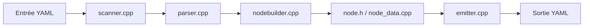

# jbeder/yaml-cpp

> Analyseur et émetteur YAML 1.2 en C++, pour développeurs C++ qui lisent ou écrivent des configurations.

## Le problème
Lire et produire du YAML depuis du C++ sans écrire son propre analyseur.

## Ce que ça fait vraiment
Le flux d'entrée passe par un scanner, un parseur qui produit des événements, puis un graphe de nœuds navigable (`Node`). Conversion vers des types C++ via `convert.h`, réémission en YAML par l'émetteur. Une interface d'événements et un adaptateur `graphbuilder` sont fournis. Version 0.9.0 annoncée ; l'ancienne API ne sera plus corrigée en 2026.

## Comment c'est branché


## Essayer
```bash
mkdir build
cd build
cmake [-G generator] [-DYAML_BUILD_SHARED_LIBS=on|OFF] ..
```

## Coût et pièges
Gratuit. Statique par défaut ; sous MSVC, la CRT statique est la valeur par défaut (`YAML_MSVC_SHARED_RT` pour changer). Les wrappers Qt et Unreal ne sont pas officiels.

## Ce que ce n'est pas
Pas une bibliothèque Python : C++ uniquement. Propriétaire unique (compte personnel).

## Alternatives
Aucune alternative nommée dans le README.

## Pour toi
À surveiller : pertinent seulement si tu écris du C++ (inférence embarquée, outils) ; en Python, ce n'est pas ton outil.

