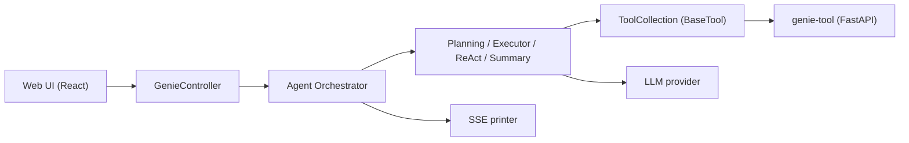

# jd-opensource/joyagent-jdgenie

> JD's end-to-end multi-agent product, which delivers HTML, PPT or Markdown reports from a request.

## The problem
Most agent projects are SDKs or frameworks: you still have to build the interface, the orchestration and the sub-agents.

## What it actually does
A request goes through a React interface, a Java 17 Spring Boot backend that orchestrates agents (planning, executor, ReAct, summary) and tools (code, search, files, reports), with SSE streaming. A Python FastAPI microservice (`genie-tool`) exposes the MCP tools. You plug in your LLM in `application.yml` and `.env_template`. The README claims 75.15% on GAIA (validation) and 65.12% (test), which I could not verify.

## How it is wired


## Trying it
```bash
git clone https://github.com/jd-opensource/joyagent-jdgenie.git
# éditer genie-backend/src/main/resources/application.yml et genie-tool/.env_template
docker build -t genie:latest .
docker run -d -p 3000:3000 -p 8080:8080 -p 1601:1601 --name genie-app genie:latest
```

## Cost and gotchas
LLM API key and Serper search key at your expense. Manual alternative: JDK 17, Python 3.11, `uv`. The documentation is mostly in Chinese. Separate branches carry multimodal RAG (`mrag`) and the DataAgent (`data_agent`). Last push in February 2026.

## What it is not
Not a lightweight SDK: it is a Java + Python + React stack to deploy. The README's comparison is self-declared. The contribution agreement requires signing a document sent by email.

## Alternatives
- OpenManus, OWL, Dify: frameworks cited in the README, lighter to integrate.

## For you
Worth watching: a complete agent that outputs reports is a good test bench, but the heavy stack and a push eight months old weigh against more active frameworks.
