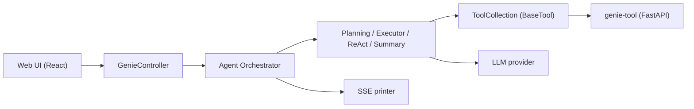

# jd-opensource/joyagent-jdgenie

> Produit multi-agents de bout en bout de JD, qui livre rapports HTML, PPT ou Markdown à partir d'une requête.

## Le problème
La plupart des projets d'agents sont des SDK ou frameworks : il reste à construire l'interface, l'orchestration et les sous-agents.

## Ce que ça fait vraiment
Une requête passe par une interface React, un backend Java 17 Spring Boot qui orchestre agents (planning, exécuteur, ReAct, synthèse) et outils (code, recherche, fichiers, rapports), avec streaming SSE. Un microservice Python FastAPI (`genie-tool`) expose les outils MCP. Tu branches ton LLM dans `application.yml` et `.env_template`. Le README revendique 75,15 % sur GAIA (validation) et 65,12 % (test), sans que je puisse le vérifier.

## Comment c'est branché


## Essayer
```bash
git clone https://github.com/jd-opensource/joyagent-jdgenie.git
# éditer genie-backend/src/main/resources/application.yml et genie-tool/.env_template
docker build -t genie:latest .
docker run -d -p 3000:3000 -p 8080:8080 -p 1601:1601 --name genie-app genie:latest
```

## Coût et pièges
Clé d'API LLM et clé de recherche Serper à ta charge. Alternative manuelle : JDK 17, Python 3.11, `uv`. La documentation est surtout en chinois. Des branches distinctes portent le RAG multimodal (`mrag`) et le DataAgent (`data_agent`). Dernier push en février 2026.

## Ce que ce n'est pas
Pas un SDK léger : c'est une pile Java + Python + React à déployer. Le comparatif du README est auto-déclaré. Le contrat de contribution demande de signer un accord envoyé par e-mail.

## Alternatives
- OpenManus, OWL, Dify : frameworks cités dans le README, plus légers à intégrer.

## Pour toi
À surveiller : un agent complet qui sort des rapports est un bon banc d'essai, mais la pile lourde et un push vieux de huit mois pèsent face à des frameworks plus actifs.

