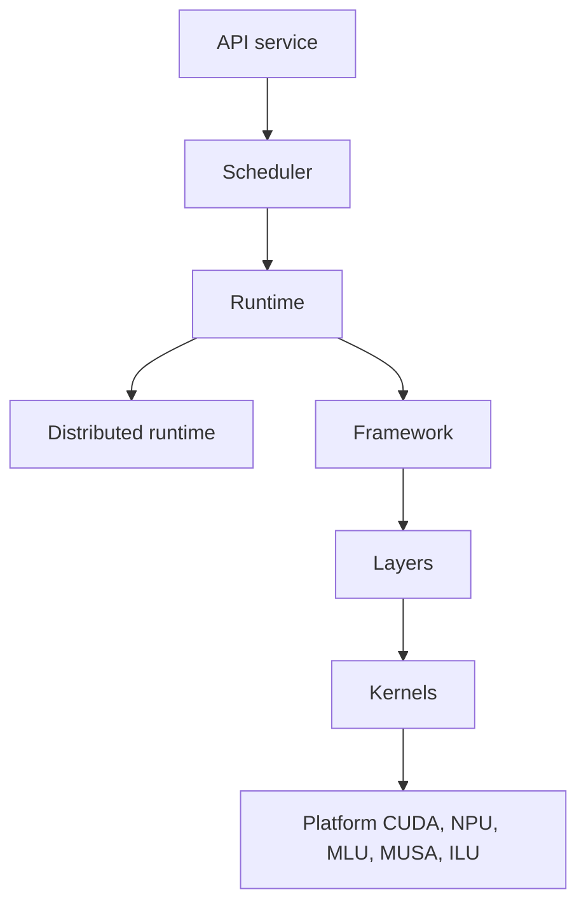

# jd-opensource/xllm

> Distributed LLM inference engine, optimized for Chinese accelerators, from JD.com.

## The problem
Serving large models on NPU, MLU or other chips requires engines designed for that hardware, not only CUDA.

## What it actually does
Separates the service layer (API, scheduling) from the engine layer (computation). The code contains several schedulers (chunked prefill, disaggregated PD), a multi-node distributed runtime and a hierarchical KV cache with prefixes. It covers LLMs, VLMs, recommendation models and image generation, with per-hardware kernels: CUDA, NPU, MLU, MUSA, ILU.

## How it is wired

## Trying it
No command in the README: the steps (Quick Start, Launch xLLM) are in the external documentation.

## Cost and gotchas
A compatible accelerator is required, with heavy dependencies (brpc, etcd, Mooncake). Per-hardware build, and the README details no steps.

## What it is not
Not a client or a simple Python library. The announced performance is not quantified in the README.

## Alternatives
No alternative named in the README.

## For you
Worth watching: serious for an MLOps engineer serving models on Chinese hardware; otherwise of little use in a classic NVIDIA GPU environment.
