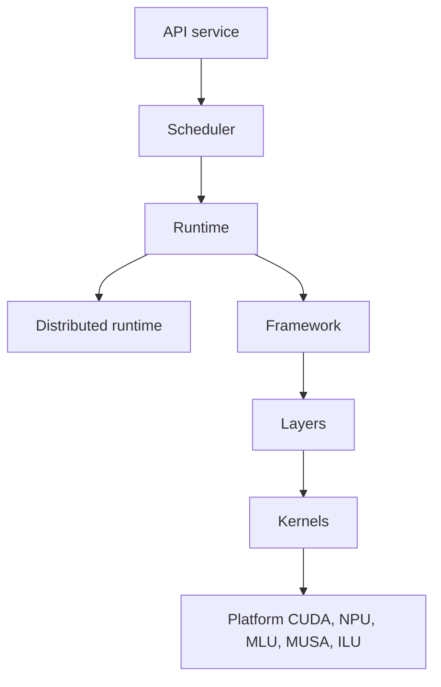

# jd-opensource/xllm

> Moteur d'inférence LLM distribué, optimisé pour les accélérateurs chinois, issu de JD.com.

## Le problème
Servir de grands modèles sur des puces NPU, MLU ou autres exige des moteurs pensés pour ce matériel, pas seulement CUDA.

## Ce que ça fait vraiment
Sépare la couche service (API, planification) de la couche moteur (calcul). Le code contient plusieurs planificateurs (prefill par morceaux, PD désagrégé), un runtime distribué multi-nœuds et un cache KV hiérarchique avec préfixes. Il couvre LLM, VLM, modèles de recommandation et génération d'images, avec des noyaux par matériel : CUDA, NPU, MLU, MUSA, ILU.

## Comment c'est branché

## Essayer
Aucune commande dans le README : les étapes (Quick Start, Launch xLLM) sont dans la documentation externe.

## Coût et pièges
Un accélérateur compatible est nécessaire, avec des dépendances lourdes (brpc, etcd, Mooncake). Compilation par matériel, et le README ne détaille aucune étape.

## Ce que ce n'est pas
Pas un client ni une bibliothèque Python simple. Les performances annoncées ne sont pas chiffrées dans le README.

## Alternatives
Aucune alternative nommée dans le README.

## Pour toi
À surveiller : sérieux pour un MLOps qui sert des modèles sur matériel chinois ; sinon peu utile en environnement GPU NVIDIA classique.

