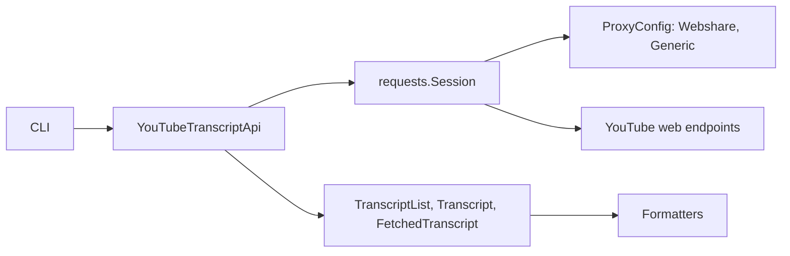

# jdepoix/youtube-transcript-api

> Python API and CLI to fetch transcripts and subtitles of YouTube videos, without a headless browser.

## The problem
Getting a video's spoken text without going through Selenium or a limited official API.

## What it actually does
Queries YouTube's web endpoints, lists the available transcripts (manual or generated), picks by language, translates on demand and returns segments with text, start and duration. Formatters produce JSON, text, SRT, WebVTT or CSV. A proxy layer (Webshare or generic proxy) works around IP blocks, and a `requests` session can be injected.

## How it is wired


## Trying it
```bash
pip install youtube-transcript-api
youtube_transcript_api <first_video_id> <second_video_id> --languages de en
youtube_transcript_api <first_video_id> --languages en --translate de
youtube_transcript_api --list-transcripts <first_video_id>
youtube_transcript_api <video_id> --format json > transcripts.json
```

## Cost and gotchas
Free, but YouTube blocks most cloud provider IPs: plan for rotating residential proxies (paid). You must pass the video ID, not the URL. Cookie authentication is currently unavailable, so age-restricted videos are inaccessible.

## What it is not
Not an official API: it relies on an undocumented part of YouTube, which may stop working without notice, as the README warns.

## Alternatives
No alternative named in the README (sponsor hosting providers are mentioned without being named).

## For you
Adopt it to feed a text pipeline (RAG, summaries) from videos: simple and quick to plug in, but plan for a proxy and a fallback in case YouTube changes its endpoint.
