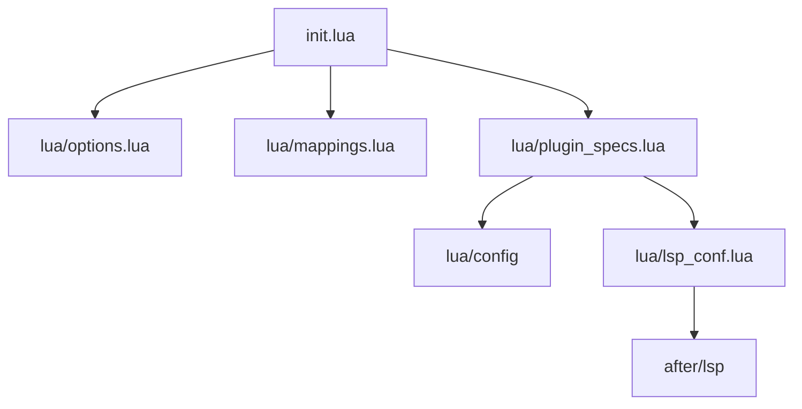

# jdhao/nvim-config

> Personal, heavily commented Neovim configuration, to pick from rather than clone whole.

## The problem
Building a complete Neovim setup (plugins, LSP, completion, git) from scratch takes time.

## What it actually does
A Lua/Vimscript configuration: `init.lua` for the terminal, `ginit.vim` for the GUI. Lazy.nvim manages plugins, declared in `lua/plugin_specs.lua`, each configured in `lua/config/`. LSP for clangd, gopls, ltex, lua_ls, pyright and ruff, plus fugitive, fzf-lua, nvim-cmp and nvim-tree. Custom commands (`Redir`, `JSONFormat`…) are added.

## How it is wired
Diagram based on the provided diagram.

## Trying it
The README gives no command: it points to an installation document per platform (Linux, macOS, Windows).

## Cost and gotchas
Free. The config only tracks the latest stable Neovim release, with no backward compatibility. The README itself advises against cloning it as is.

## What it is not
Not a ready-to-use Neovim distribution nor a supported tool: it is a personal config.

## Alternatives
No alternative named in the README.

## For you
Keep an eye on it: a good source of ideas for your own config (pyright and ruff already wired), to copy piece by piece and not wholesale.
