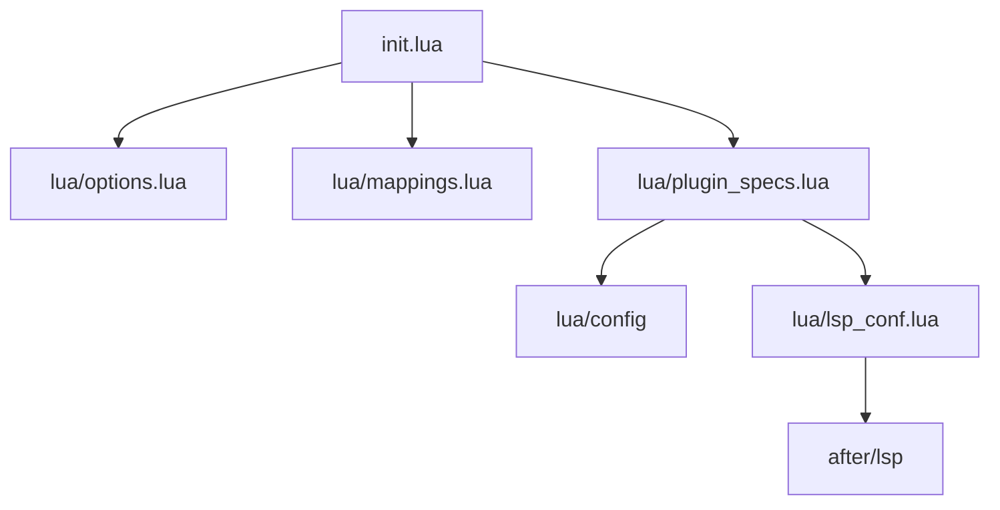

# jdhao/nvim-config

> Configuration Neovim personnelle et très commentée, à piocher plutôt qu'à cloner en entier.

## Le problème
Monter une configuration Neovim complète (plugins, LSP, complétion, git) à partir de zéro prend du temps.

## Ce que ça fait vraiment
Une configuration Lua/Vimscript : `init.lua` pour le terminal, `ginit.vim` pour l'interface graphique. Lazy.nvim gère les plugins, déclarés dans `lua/plugin_specs.lua`, chacun configuré dans `lua/config/`. LSP pour clangd, gopls, ltex, lua_ls, pyright et ruff, plus fugitive, fzf-lua, nvim-cmp et nvim-tree. Des commandes perso (`Redir`, `JSONFormat`…) s'ajoutent.

## Comment c'est branché
Schéma d'après le diagramme fourni.

## Essayer
Le README ne donne pas de commande : il renvoie à un document d'installation par plateforme (Linux, macOS, Windows).

## Coût et pièges
Gratuit. La config ne suit que la dernière version stable de Neovim, sans compatibilité ascendante. Le README déconseille lui-même de la cloner telle quelle.

## Ce que ce n'est pas
Pas une distribution Neovim prête à l'emploi ni un outil supporté : c'est une config personnelle.

## Alternatives
Aucune alternative nommée dans le README.

## Pour toi
À surveiller : bonne source d'idées pour ta propre config (pyright et ruff déjà branchés), à copier par morceaux et non en bloc.

