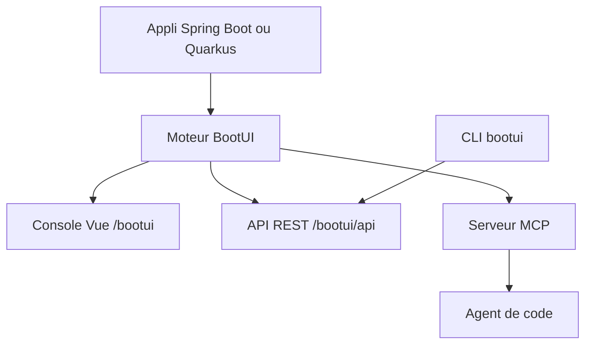

# jdubois/boot-ui

> Local development console built into Spring Boot and Quarkus applications, with an MCP server.

## The problem
Understanding what happens in a Java application locally forces you to juggle logs, tools and configurations.

## What it actually does
Adds a local dashboard (`/bootui`) to your application with a runtime journal, run comparison and diagnostics. An optional MCP server lets coding agents (Copilot, Claude Code, Cursor) read these diagnostics. A `bootui` CLI queries the application and outputs JSON, with exit codes for CI.

## How it is wired
Simplified diagram based on the sheet, no diagram provided.



## Trying it
```bash
npx skills add https://github.com/jdubois/boot-ui/tree/main/skills/bootui
gh skill install jdubois/boot-ui skills/bootui
curl -fsSL https://www.julien-dubois.com/boot-ui/install.sh | sh
bootui beans --query dataSource
```

## Cost and gotchas
Requires a Java stack (Spring Boot or Quarkus), missing from the prerequisites list. The install script goes through `curl | sh`. Active only in local development.

## What it is not
Not a production monitoring tool. Not useful outside the Java world. The limits of version 2.0 are deferred to a separate page.

## Alternatives
No alternative named in the README.

## For you
Ignore: reserved for Spring Boot or Quarkus developers, far from the data / AI stack, unless you maintain Java services.
