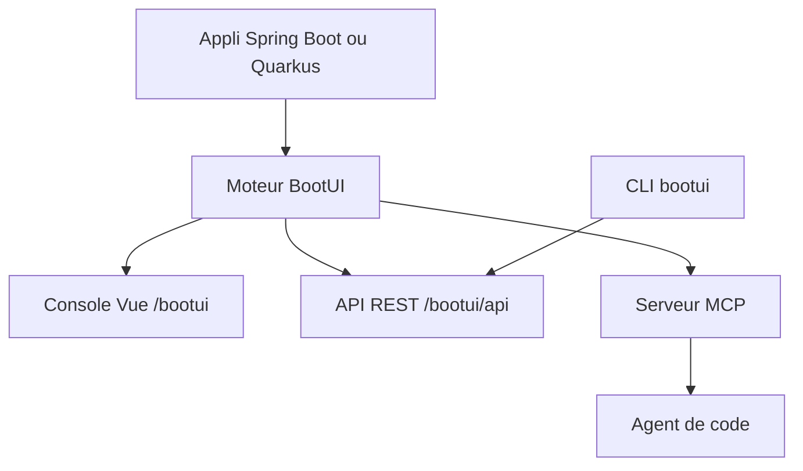

# jdubois/boot-ui

> Console de développement locale intégrée aux applications Spring Boot et Quarkus, avec serveur MCP.

## Le problème
Comprendre ce qui se passe dans une application Java en local oblige à jongler entre logs, outils et configurations.

## Ce que ça fait vraiment
Ajoute à ton application un tableau de bord local (`/bootui`) avec journal d'exécution, comparaison de runs et diagnostics. Un serveur MCP optionnel permet à des agents de code (Copilot, Claude Code, Cursor) de lire ces diagnostics. Une CLI `bootui` interroge l'application et sort du JSON, avec des codes de sortie pour la CI.

## Comment c'est branché
Schéma simplifié d'après la fiche, sans diagramme fourni.



## Essayer
```bash
npx skills add https://github.com/jdubois/boot-ui/tree/main/skills/bootui
gh skill install jdubois/boot-ui skills/bootui
curl -fsSL https://www.julien-dubois.com/boot-ui/install.sh | sh
bootui beans --query dataSource
```

## Coût et pièges
Demande une pile Java (Spring Boot ou Quarkus), absente de la liste des prérequis. Le script d'installation passe par `curl | sh`. Actif seulement en développement local.

## Ce que ce n'est pas
Pas un outil de supervision de production. Pas utile hors du monde Java. Les limites de la version 2.0 sont renvoyées à une page à part.

## Alternatives
Aucune alternative nommée dans le README.

## Pour toi
Ignorer : réservé aux développeurs Spring Boot ou Quarkus, loin de la pile data / IA, sauf si tu maintiens des services Java.

