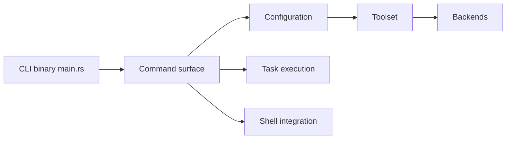

# jdx/mise

> Per-project manager for tools, environment variables and tasks, all in a single `mise.toml`.

## The problem
Each project demands its own versions of Node, Python or Terraform, its own environment variables and commands, which are hard to reproduce across machines and CI.

## What it actually does
Installs tools from a registry of more than 1,000, picks the version per project, loads variables and `.env` files, runs tasks with the project's tools, and can set up an entire machine (`mise bootstrap`). Multiple backends (GitHub, npm, Cargo, aqua…), shims, lockfile, plugins. Rust binary.

## How it is wired


## Trying it
```bash
curl https://mise.run | sh
mise exec node@24 -- node --version
mise use node@24
mise run hello
mise doctor
```

## Cost and gotchas
Free. `"24"` is a series request, not an exact pin: use the lockfile to share precise versions. The install script goes through `curl | sh`.

## What it is not
Not a full Python package manager (the README mentions uv separately) nor a build engine.

## Alternatives
No alternative named in the README.

## For you
Adopt: pins the versions of Python and tools for an ML or MLOps project, and runs tasks the same way locally and in CI.
