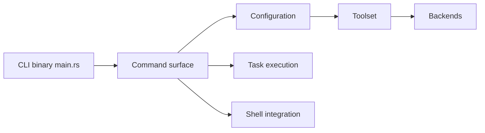

# jdx/mise

> Gestionnaire d'outils, de variables d'environnement et de tâches par projet, dans un seul `mise.toml`.

## Le problème
Chaque projet exige ses versions de Node, Python ou Terraform, ses variables d'environnement et ses commandes, difficiles à reproduire entre machines et CI.

## Ce que ça fait vraiment
Installe des outils depuis un registre de plus de 1 000, choisit la version par projet, charge variables et fichiers `.env`, lance des tâches avec les outils du projet, et peut préparer une machine entière (`mise bootstrap`). Backends multiples (GitHub, npm, Cargo, aqua…), shims, lockfile, plugins. Binaire Rust.

## Comment c'est branché


## Essayer
```bash
curl https://mise.run | sh
mise exec node@24 -- node --version
mise use node@24
mise run hello
mise doctor
```

## Coût et pièges
Gratuit. `"24"` est une demande de série, pas un épinglage exact : utiliser le lockfile pour partager des versions précises. Le script d'installation passe par `curl | sh`.

## Ce que ce n'est pas
Pas un gestionnaire de paquets Python complet (le README cite uv à part) ni un moteur de build.

## Alternatives
Aucune alternative nommée dans le README.

## Pour toi
À adopter : fige les versions de Python et des outils d'un projet ML ou MLOps, et fait tourner les tâches pareil en local et en CI.

