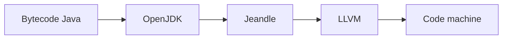

# jeandle/jeandle-jdk

> Just-in-time compiler for Java, built on OpenJDK and LLVM, still a work in progress.

## The problem
Getting more optimized machine code for the Java virtual machine than the current just-in-time compiler produces.

## What it actually does
Replaces OpenJDK's just-in-time compilation with code generation going through LLVM. The README is limited to an introduction and links (getting started guide, JVM options, debugging guide) that are not provided. No performance measurements.

## How it is wired
Simplified diagram based on the sheet, no diagram provided.

## Trying it
No command documented in the README: everything is deferred to "Getting Started".

## Cost and gotchas
Free; building requires an OpenJDK and LLVM build toolchain, not detailed here. GPL-2.0 license (copyleft). The project declares itself under development.

## What it is not
Not a production-ready JDK, according to its own README. Not a data science tool.

## Alternatives
No alternative named in the README.

## For you
Ignore: low-level tool for JVM specialists, unrelated to a data/AI/MLOps profile and with too little material to judge.
