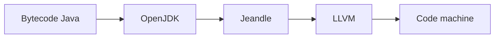

# jeandle/jeandle-jdk

> Compilateur à la volée pour Java, bâti sur OpenJDK et LLVM, encore en chantier.

## Le problème
Obtenir du code machine plus optimisé pour la machine virtuelle Java que celui du compilateur à la volée actuel.

## Ce que ça fait vraiment
Remplace la compilation à la volée d'OpenJDK par une génération de code passant par LLVM. Le README se limite à une introduction et à des liens (guide de démarrage, options JVM, guide de débogage) non fournis. Aucune mesure de performance.

## Comment c'est branché
Schéma simplifié d'après la fiche, sans diagramme fourni.

## Essayer
Aucune commande documentée dans le README : tout est renvoyé vers « Getting Started ».

## Coût et pièges
Gratuit ; la compilation demande une chaîne de construction OpenJDK et LLVM, non détaillée ici. Licence GPL-2.0 (copyleft). Le projet se déclare en cours de développement.

## Ce que ce n'est pas
Pas un JDK prêt pour la production, selon son propre README. Pas un outil de data science.

## Alternatives
Aucune alternative nommée dans le README.

## Pour toi
À ignorer : outil de bas niveau pour spécialistes de la JVM, sans lien avec un profil data/IA/MLOps et sans matière pour juger.

