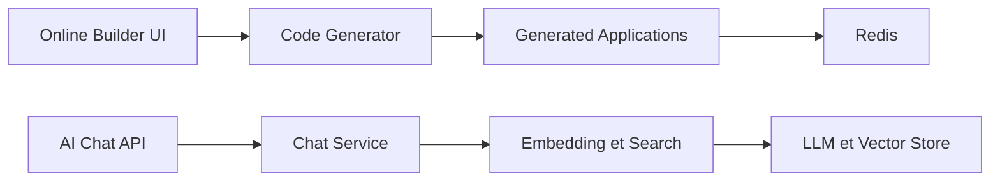

# jeecgboot/JeecgBoot

> Chinese low-code Java/Vue development platform with an AI layer: application, knowledge base, and RAG (Retrieval-Augmented Generation).

## The problem
Business management projects (such as OA, ERP, and CRM) repeatedly implement the same basic functions: creating, reading, updating, and deleting data, as well as managing forms and access rights.

## What it actually does
Code generator (online forms, tables, CRUD, menus and permissions), form designers, Flowable workflows, reports and dashboards. AI module: chat, knowledge base with RAG, workflow orchestration, MCP, plugins, ChatGPT, DeepSeek, Ollama via langchain4j. Spring Boot 4, Vue 3, optional Spring Cloud Alibaba microservices. Documentation in Chinese.

## How it is wired

## Trying it
There are no commands in the README: it refers to the documentation (starting via IDEA or Docker, with the default account `admin/123456`).

## Cost and gotchas
Free; you are responsible for providing the language models. The default password is weak and should be changed. Up to ~44 functions are advertised: the README is a comprehensive catalog.

## What it is not
Not a leading AI platform compared to Dify: AI is a module within a Java-based enterprise framework.

## Alternatives
Dify, which is mentioned in the README as a point of comparison.

## For you
To be aware of: This is only relevant if you are developing Java-based enterprise applications with a RAG (Retrieval-Augmented Generation) layer; otherwise, it is outside the scope of data/MLOps.
