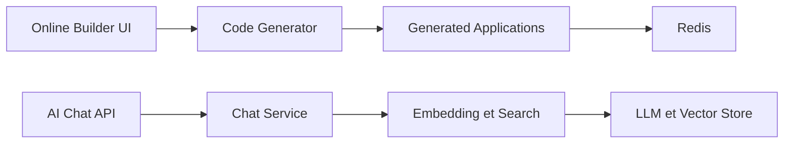

# jeecgboot/JeecgBoot

> Plateforme chinoise de développement low-code Java/Vue avec couche IA : application, base de connaissances, RAG.

## Le problème
Les projets de gestion d'entreprise (OA, ERP, CRM) refont sans cesse les mêmes CRUD, formulaires et droits d'accès.

## Ce que ça fait vraiment
Générateur de code (formulaires en ligne, tables, CRUD, menus et droits), designers de formulaires, flux Flowable, rapports et écrans de pilotage. Module IA : chat, base de connaissances avec RAG, orchestration de flux, MCP, plugins, modèles ChatGPT, DeepSeek, Ollama via langchain4j. Pile Spring Boot 4, Vue 3, microservices Spring Cloud Alibaba optionnels. Documentation en chinois.

## Comment c'est branché

## Essayer
Aucune commande dans le README : il renvoie à la documentation (démarrage via IDEA ou Docker, compte `admin/123456` par défaut).

## Coût et pièges
Gratuit ; modèles de langage à ta charge. Mot de passe par défaut faible à changer. Jusqu'à ~44 fonctions annoncées : le README est un catalogue sans mesure.

## Ce que ce n'est pas
Pas une plateforme IA de référence face à Dify : l'IA est un module d'un framework Java d'entreprise.

## Alternatives
Dify, cité dans le README comme point de comparaison.

## Pour toi
À surveiller : pertinent seulement si tu montes des applications d'entreprise Java avec une couche RAG ; sinon hors périmètre data/MLOps.

