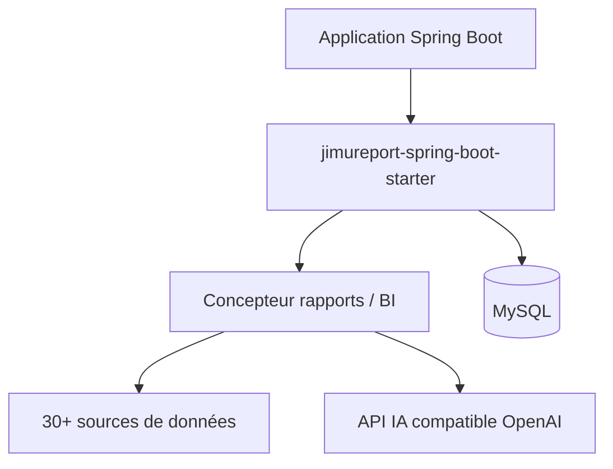

# jeecgboot/jimureport

> Reporting, data screens and conversational BI tool to embed in a Spring Boot application.

## The problem
Designing complex reports, printouts and dashboards requires expensive or limited commercial tools.

## What it actually does
Online Excel-style report designer (groups, pivots, printing, data entry), screen and dashboard designers, plus an AI assistant (JimuChatBI) plugged into any OpenAI-compatible API. More than 30 data sources. Integrates as a Spring Boot 2, 3 or 4 Maven dependency. Claude Code skills are provided in a separate repository.

## How it is wired

Diagram inferred from the README; no diagram provided.

## Trying it
```
git clone https://github.com/jeecgboot/skills.git ~/.claude/skills
```
Integration: add the Maven dependency `jimureport-spring-boot3-starter` 2.5.6.1, then run the initialization SQL.

## Cost and gotchas
JDK 17+ and MySQL 5.7+ for the example. The AI requires a key from a provider (DeepSeek, OpenAI...). `autoTableEnabled` lets the AI write to the database: leave it `false` in production.

## What it is not
Not fully free: the README states non-open code, a ban on competing products, copyright to be kept, and a commercial licence to remove the branding. It also mentions LGPL and GPL-3.0, contradictorily.

## Alternatives
No alternative named in the README.

## For you
Ignore: ambiguous licence, Java and Chinese ecosystem, limited benefit for a data/AI profile outside Spring integration.
