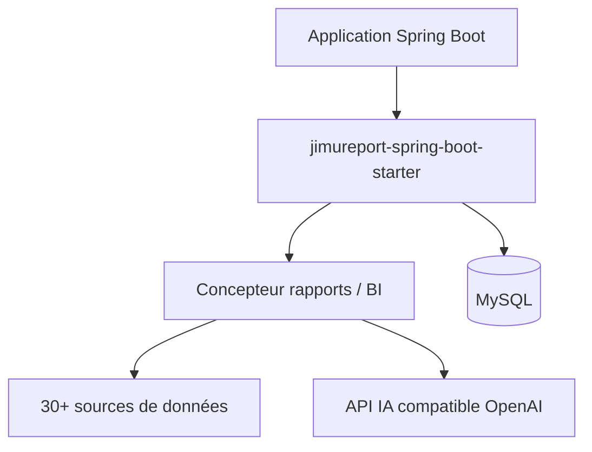

# jeecgboot/jimureport

> Outil de rapports, écrans de données et BI conversationnelle à intégrer dans une application Spring Boot.

## Le problème
Concevoir des rapports complexes, des impressions et des tableaux de bord demande des outils commerciaux chers ou limités.

## Ce que ça fait vraiment
Concepteur de rapports en ligne de type Excel (groupes, croisés, impression, saisie), concepteurs d'écrans et de tableaux de bord, plus un assistant IA (JimuChatBI) branché sur toute API compatible OpenAI. Plus de 30 sources de données. S'intègre comme dépendance Maven Spring Boot 2, 3 ou 4. Compétences Claude Code fournies dans un dépôt séparé.

## Comment c'est branché

Schéma déduit du README ; aucun diagramme fourni.

## Essayer
```
git clone https://github.com/jeecgboot/skills.git ~/.claude/skills
```
Intégration : ajouter la dépendance Maven `jimureport-spring-boot3-starter` 2.5.6.1, puis exécuter le SQL d'initialisation.

## Coût et pièges
JDK 17+ et MySQL 5.7+ pour l'exemple. L'IA exige une clé d'un fournisseur (DeepSeek, OpenAI…). `autoTableEnabled` permet à l'IA d'écrire en base : à laisser à `false` en production.

## Ce que ce n'est pas
Pas entièrement libre : le README annonce code non ouvert, interdiction de produit concurrent, copyright à conserver, licence commerciale pour retirer la marque. Il mentionne aussi LGPL et GPL-3.0, de façon contradictoire.

## Alternatives
Aucune alternative nommée dans le README.

## Pour toi
Ignorer : licence ambiguë, écosystème Java et chinois, bénéfice limité pour un profil data/IA hors intégration Spring.

