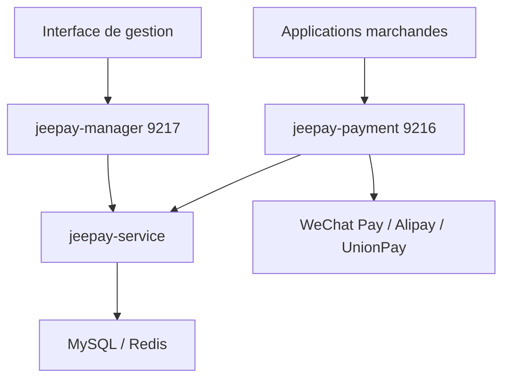

# jeequan/jeepay

> Open source payment system for Chinese businesses: merchants, WeChat Pay and Alipay aggregation.

## The problem
Wiring payment channels, merchants and callbacks into a platform takes a lot of repetitive code.

## What it actually does
Spring Boot 3.3.7 platform with JDK 17, Ant Design Vue on the interface side. Three services: payment gateway (9216), management platform (9217), merchant system (9218), on top of a central service. It handles the ordinary merchant, service provider and aggregated code payment modes. Channels: WeChat Pay, Alipay, UnionPay. It uses MySQL, Redis and RocketMQ, ActiveMQ or RabbitMQ.

## How it is wired

## Trying it
Detailed commands are in `docs/deploy/shell.md` and `docs/deploy/compose.md`: not reproduced in the README. No command documented in the README itself.

## Cost and gotchas
Free for the code, but you need accounts and contracts with the payment channels, plus MySQL, Redis, a message queue and an HTTPS domain. Java 17 is required (not listed: a real prerequisite). The README also offers a hosted service, "计全付", which is paid, with custom pricing.

## What it is not
It is not a payment license: the channels are at your expense. The README is in Chinese, as are the targeted channels.

## Alternatives
No alternative named in the README.

## For you
Ignore: a Chinese payment platform, outside the data, AI or MLOps scope.
