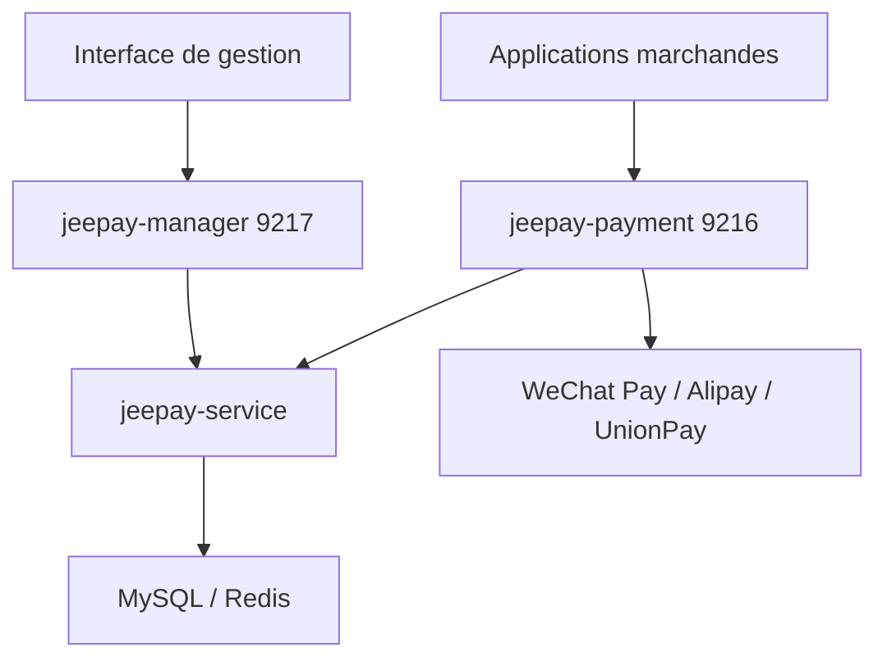

# jeequan/jeepay

> Système de paiement open source pour entreprises chinoises : marchands, agrégation WeChat Pay et Alipay.

## Le problème
Brancher des canaux de paiement, des marchands et des callbacks sur une plateforme demande beaucoup de code répétitif.

## Ce que ça fait vraiment
Plateforme Spring Boot 3.3.7 avec JDK 17, Ant Design Vue côté interface. Trois services : passerelle de paiement (9216), plateforme de gestion (9217), système marchand (9218), sur un service central. Elle gère les modes marchand ordinaire, prestataire de services et paiement par code agrégé. Canaux : WeChat Pay, Alipay, UnionPay. Elle utilise MySQL, Redis et RocketMQ, ActiveMQ ou RabbitMQ.

## Comment c'est branché

## Essayer
Les commandes détaillées sont dans `docs/deploy/shell.md` et `docs/deploy/compose.md` : non reproduites dans le README. Aucune commande documentée dans le README lui-même.

## Coût et pièges
Gratuit côté code, mais il faut des comptes et contrats auprès des canaux de paiement, plus MySQL, Redis, un MQ et un domaine HTTPS. Java 17 est requis (non listé : prérequis réel). Le README propose aussi un service hébergé « 计全付 », payant, aux tarifs sur mesure.

## Ce que ce n'est pas
Ce n'est pas une licence de paiement : il faut des canaux à ta charge. Le README est en chinois, tout comme les canaux ciblés.

## Alternatives
Aucune alternative nommée dans le README.

## Pour toi
À ignorer : plateforme de paiement chinoise, hors du périmètre data, IA ou MLOps.

