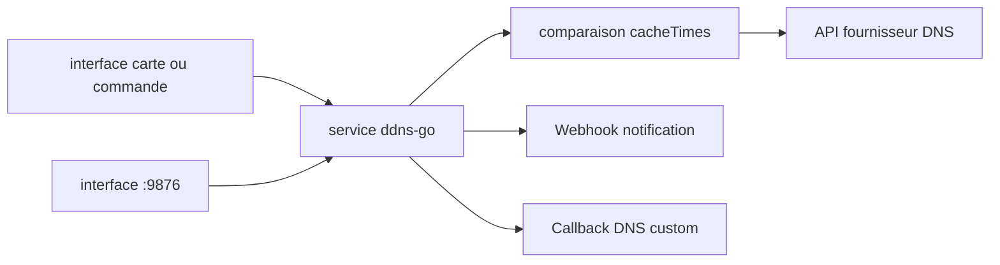

# jeessy2/ddns-go

> Gets your public IPv4 or IPv6 address and updates the matching DNS record.

## The problem
A home connection changes its public IP without warning, and the domain name then points nowhere.
Homemade DNS update scripts break at the first provider API change.

## What it actually does
Syncs every 5 minutes by default, with `-f` for the interval and `-cacheTimes` to space out comparisons.
Covers about twenty providers: Cloudflare, GoDaddy, Namecheap, NameSilo, Porkbun, Gcore, deSEC, Aliyun, Tencent, Huawei…
Obtains the IP from a network interface, an API call or a command, and handles several providers and domains at once.
Web interface on port 9876, showing the last 50 logs, with the "forbid access from the internet" option checked by default.

## How it is wired


## Trying it
```bash
docker run -d --name ddns-go --restart=always --net=host -v /opt/ddns-go:/root jeessy/ddns-go
```
As a system service: `sudo ./ddns-go -s install -f 600 -c /Users/name/.ddns_go_config.yaml`,
then the interface at `http://localhost:9876`. Reset: `./ddns-go -resetPassword 123456`.

## Cost and gotchas
If you expose the interface to the internet, the README recommends a reverse proxy with HTTPS (Nginx).
Watch out for provider-side rate limiting if you fetch the IP via an API with a short interval.

## What it is not
Not a DNS server: it updates records at a provider, it hosts none.
Not usable on Docker Desktop Windows/macOS for IPv6: `--net=host` is not supported there.
Not an IPv6 guarantee in a virtual machine: the address may be obtained without being reachable.

## Alternatives
`Callback` — the built-in mechanism to cover a DNS provider missing from the list.
`ddns-telegram-bot` — cited for notification via Telegram.

## For you
Outside your field, but it is the building block that makes your homelab reachable: ten minutes, then you forget about it.
