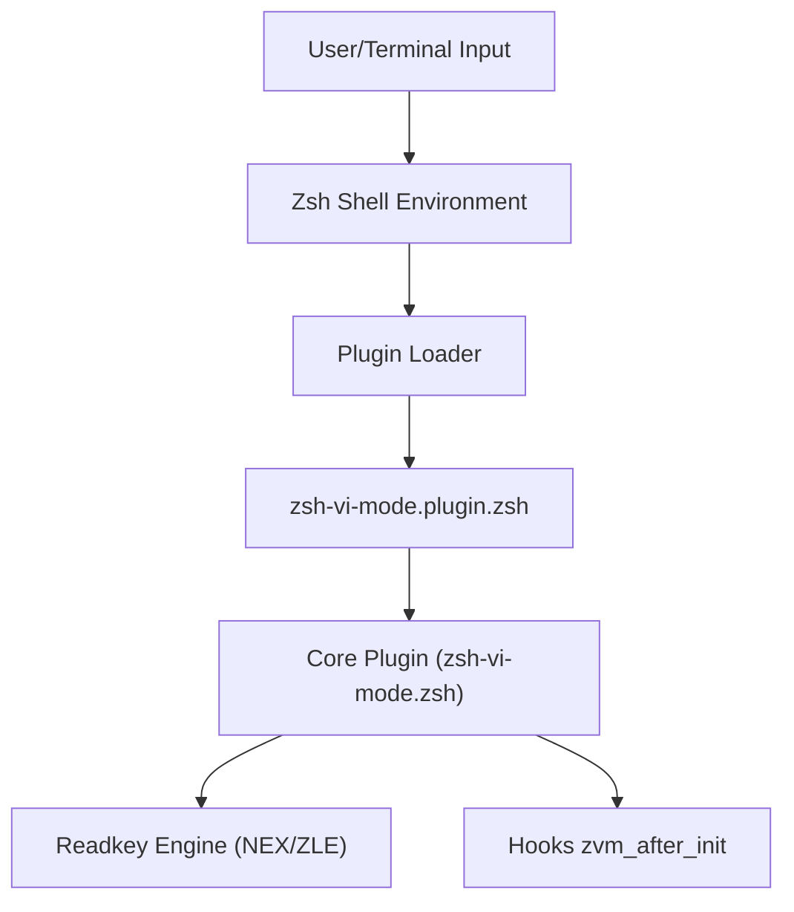

# jeffreytse/zsh-vi-mode

> Zsh plugin that replaces the default vi mode with a Vim-like version, with no dependencies.

## The problem
Zsh's native vi mode is incomplete and behaves differently from Vim: text objects, surrounds and delays are lacking.

## What it actually does
Pure Zsh script (Zsh 5.1 or later) that adds normal, insert, visual and replace modes with an adapted cursor, text objects, surrounds (`cs"'`, `ds"`), incrementing of numbers, booleans and days, `gx` to open a link, `vv` to edit the line in the editor, system clipboard integration and OSC 52. Initialization and bindings are lazy.

## How it is wired
Diagram based on the provided diagram.



## Trying it
```bash
git clone https://github.com/jeffreytse/zsh-vi-mode.git $HOME/.zsh-vi-mode
source $HOME/.zsh-vi-mode/zsh-vi-mode.plugin.zsh
```

## Cost and gotchas
Free. The plugin overwrites key bindings (fzf for example): re-run those plugins via `zvm_after_init_commands`. The NEX readkey engine is in beta.

## What it is not
Not a theme or a plugin framework: it is a vi-mode layer only. The system clipboard is disabled by default.

## Alternatives
No alternative named in the README (vim-surround and vim-sandwich are inspirations).

## For you
Adopt it if you live in a Zsh terminal and know Vim: a daily comfort gain for editing long MLOps commands, with no cost or dependency.
