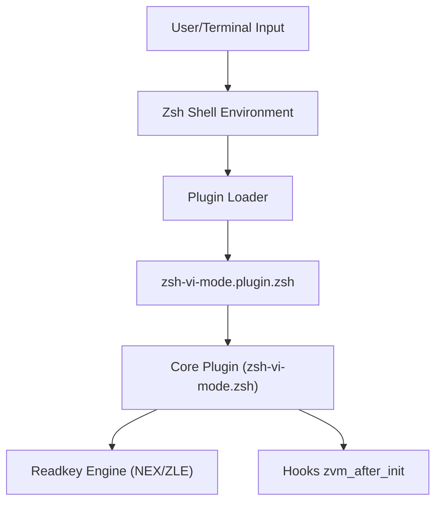

# jeffreytse/zsh-vi-mode

> Plugin Zsh qui remplace le mode vi par défaut par une version proche de Vim, sans dépendance.

## Le problème
Le mode vi natif de Zsh est incomplet et se comporte différemment de Vim : objets texte, surrounds et délais laissent à désirer.

## Ce que ça fait vraiment
Script Zsh pur (Zsh 5.1 ou plus) qui ajoute modes normal, insertion, visuel et remplacement avec curseur adapté, objets texte, surrounds (`cs"'`, `ds"`), incrément de nombres, booléens, jours, `gx` pour ouvrir un lien, `vv` pour éditer la ligne dans l'éditeur, intégration du presse-papiers système et OSC 52. Initialisation et liaisons sont paresseuses.

## Comment c'est branché
Schéma d'après le diagramme fourni.



## Essayer
```bash
git clone https://github.com/jeffreytse/zsh-vi-mode.git $HOME/.zsh-vi-mode
source $HOME/.zsh-vi-mode/zsh-vi-mode.plugin.zsh
```

## Coût et pièges
Gratuit. Le plugin écrase des liaisons de touches (fzf par exemple) : relancer ces plugins via `zvm_after_init_commands`. Le moteur de lecture NEX est en bêta.

## Ce que ce n'est pas
Pas un thème ni un framework de plugins : c'est une couche de mode vi seule. Le presse-papiers système est désactivé par défaut.

## Alternatives
Aucune alternative nommée dans le README (vim-surround et vim-sandwich sont des inspirations).

## Pour toi
À adopter si tu vis dans un terminal Zsh et connais Vim : gain de confort quotidien pour éditer des commandes longues de MLOps, sans coût ni dépendance.

