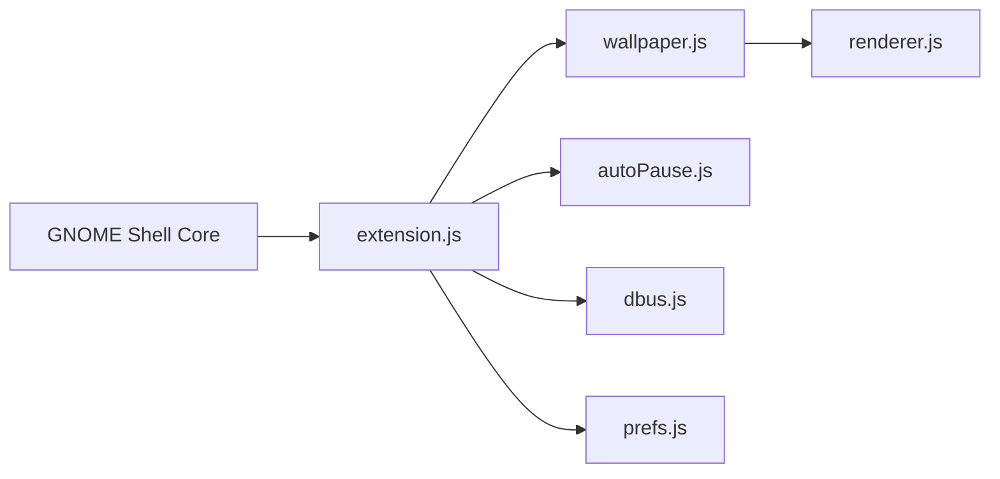

# jeffshee/gnome-ext-hanabi

> GNOME Shell extension that displays a video as an animated wallpaper on the desktop.

## The problem
GNOME has no native video wallpaper.

## What it actually does
Plays a video in the background through GStreamer (`gtk4paintablesink`, or `clappersink` as an option), with automatic pause, a panel menu and preferences. The main branch is rewritten in TypeScript for GNOME 50+ on Wayland only; the `javascript` branch remains in maintenance for GNOME 45–50. A scripting guide exists. Known crash risk with `clappersink` and GStreamer 1.26+.

## How it is wired


## Trying it
```bash
git clone https://github.com/jeffshee/gnome-ext-hanabi.git
cd gnome-ext-hanabi
make install
```
Old branch: `git clone https://github.com/jeffshee/gnome-ext-hanabi.git -b javascript`.

## Cost and gotchas
Free; meson (plus node and npm on main). Restart GNOME Shell. GPU/CPU consumption due to permanent video playback.

## What it is not
Not compatible with X11 on the new branch. Not a productivity tool.

## Alternatives
No alternative named in the README.

## For you
Ignore: desktop decoration, unrelated to data or AI.
