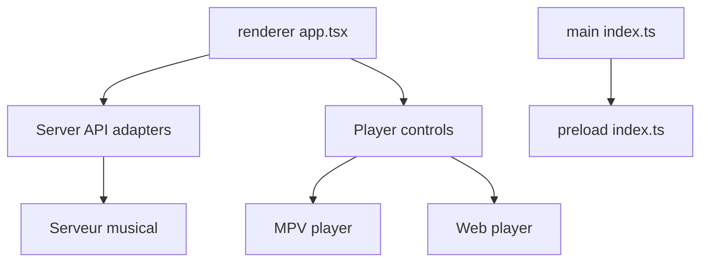

# jeffvli/feishin

> Music client for Jellyfin, Navidrome and Subsonic servers, on desktop, web or Docker.

## The problem
Listening to your self-hosted music library with a modern interface, lyrics and an MPV player.

## What it actually does
A rewrite of Sonixd: MPV or web player, synced or unsynced lyrics, scrobbling to the server, a smart playlist editor for Navidrome, a web remote control for phones and DLNA. Desktop version in Electron, web version, Docker image.

## How it is wired


## Trying it
```bash
docker run --name feishin -p 9180:9180 ghcr.io/jeffvli/feishin:latest
pnpm run dev
pnpm run build
```

## Cost and gotchas
Free, but you already need a music server. MPV must be installed for the desktop version (version 0.34.x is broken). Umami analytics is active in the web and Docker versions; turn it off with `ANALYTICS_DISABLED=true`.

## What it is not
Not a music server: it only connects to Jellyfin, Navidrome or Subsonic.

## Alternatives
Sonixd, of which this is the rewrite (cited in the README).

## For you
Ignore: a music client unrelated to data, AI or MLOps.
