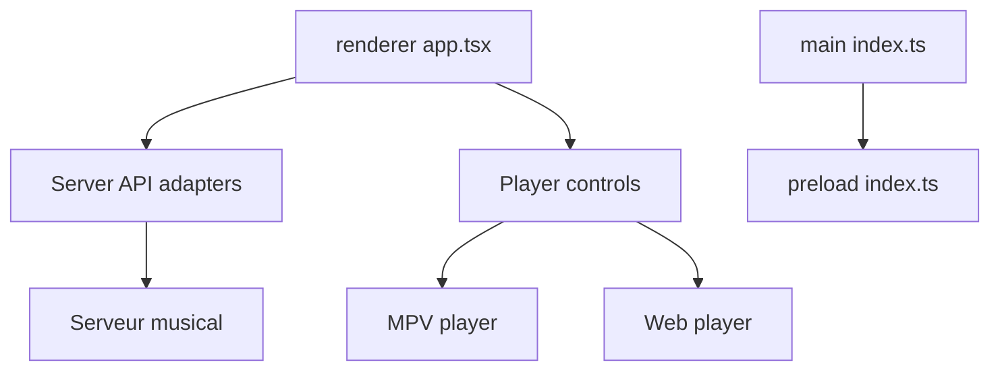

# jeffvli/feishin

> Client de musique pour serveurs Jellyfin, Navidrome et Subsonic, en bureau, web ou Docker.

## Le problème
Écouter sa bibliothèque musicale auto-hébergée avec une interface moderne, des paroles et un lecteur MPV.

## Ce que ça fait vraiment
Réécriture de Sonixd : lecteur MPV ou web, paroles synchronisées ou non, scrobbling vers le serveur, éditeur de playlists intelligentes pour Navidrome, télécommande web pour téléphone et DLNA. Version bureau en Electron, version web, image Docker.

## Comment c'est branché


## Essayer
```bash
docker run --name feishin -p 9180:9180 ghcr.io/jeffvli/feishin:latest
pnpm run dev
pnpm run build
```

## Coût et pièges
Gratuit, mais il faut déjà un serveur musical. MPV à installer pour la version bureau (version 0.34.x cassée). L'analytique Umami est active dans la version web et Docker, à couper avec `ANALYTICS_DISABLED=true`.

## Ce que ce n'est pas
Pas un serveur de musique : il ne fait que se connecter à Jellyfin, Navidrome ou Subsonic.

## Alternatives
Sonixd, dont c'est la réécriture (cité dans le README).

## Pour toi
À ignorer : client musical sans rapport avec data, IA ou MLOps.

