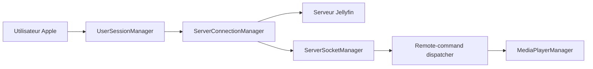

# jellyfin/Swiftfin

> Native Apple video client (iOS, tvOS) for Jellyfin media servers.

## The problem
Watching your Jellyfin library on Apple devices with native rendering and direct playback.

## What it actually does
Restores the user session, resolves the reachable server address (probing the public system info endpoint), maintains a real-time socket for remote commands, then plays through a native player or VLC. Server administration screens, live TV guide, Nuke image cache.

## How it is wired


## Trying it
```bash
# Aucune commande dans le README : installation via App Store ou TestFlight.
```

## Cost and gotchas
Requires an existing Jellyfin server and an Apple device. TestFlight is used to test new features before release.

## What it is not
Not a server: only a client. The wiring between catalog and player is not established by the code analysis.

## Alternatives
- No alternative cited in the README.

## For you
Ignore: consumer streaming client with no link to data/AI/MLOps work.
