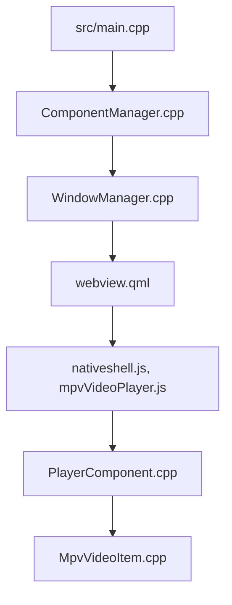

# jellyfin/jellyfin-desktop

> Desktop client for Jellyfin, built on Qt WebEngine and libmpv, to play more formats without transcoding.

## The problem
The Jellyfin web client transcodes more and supports neither audio passthrough nor advanced hardware decoding.

## What it actually does
A C++/Qt application that hosts the Jellyfin web client and delegates playback to libmpv: hardware decoding, audio passthrough, many formats. It handles keyboard, SDL gamepads, CEC, LIRC and media keys, plus MPRIS on Linux. Data is kept per profile.

## How it is wired


## Trying it
```bash
# Aucune commande dans le README : télécharger Flathub (Linux) ou les builds
# de développement ; la compilation est décrite dans dev/.
```

## Cost and gotchas
Free, but you need an existing Jellyfin server. The builds offered follow the latest commit on master. 382 open issues.

## What it is not
Not a media server: it is only the client. The screens come from the web client, not from native code.

## Alternatives
No alternative named in the README.

## For you
Ignore: a consumer media client unrelated to data or AI.
