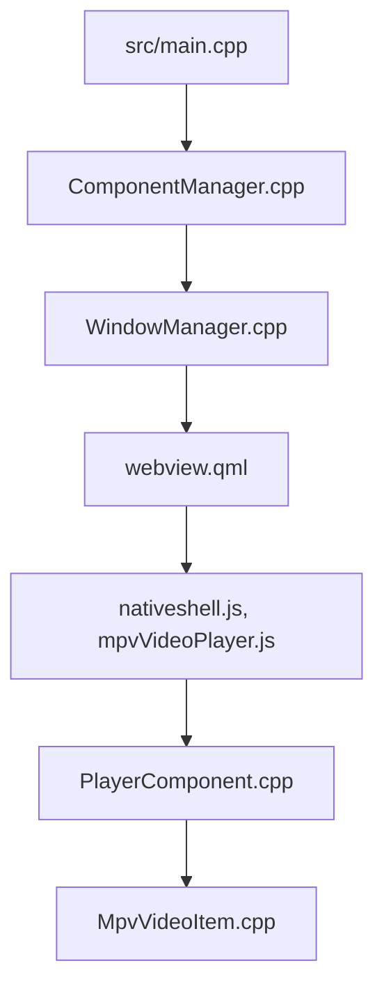

# jellyfin/jellyfin-desktop

> Client de bureau pour Jellyfin, fondé sur Qt WebEngine et libmpv, pour lire plus de formats sans transcodage.

## Le problème
Le client web de Jellyfin transcode davantage et ne gère ni passthrough audio ni décodage matériel avancé.

## Ce que ça fait vraiment
Application C++/Qt qui héberge le client web Jellyfin et délègue la lecture à libmpv : décodage matériel, passthrough audio, nombreux formats. Gère clavier, manettes SDL, CEC, LIRC et touches multimédia, plus MPRIS sous Linux. Données par profil.

## Comment c'est branché


## Essayer
```bash
# Aucune commande dans le README : télécharger Flathub (Linux) ou les builds
# de développement ; la compilation est décrite dans dev/.
```

## Coût et pièges
Gratuit, mais il faut un serveur Jellyfin existant. Les builds proposés suivent le dernier commit de master. 382 issues ouvertes.

## Ce que ce n'est pas
Pas un serveur multimédia : c'est uniquement le client. Les écrans viennent du client web, pas de code natif.

## Alternatives
Aucune alternative nommée dans le README.

## Pour toi
À ignorer : client multimédia grand public sans rapport avec la data ou l'IA.

