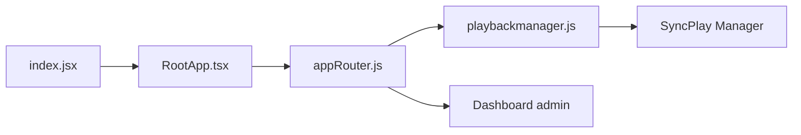

# jellyfin/jellyfin-web

> Web interface of the Jellyfin media server, the basis of most user clients.

## The problem
The Jellyfin server needs a front end to browse the library, play media and administer.

## What it actually does
Frontend serving browsers, Android and iOS: server login, browsing, search, Live TV, playback, SyncPlay (shared playback) and an admin dashboard (scheduled tasks, backups, plugins). It only works with a Jellyfin server.

## How it is wired


## Trying it
```sh
git clone https://github.com/jellyfin/jellyfin-web.git
cd jellyfin-web
npm install
npm start
npm run build:development
```

## Cost and gotchas
Free. Node.js and npm required; a Jellyfin server is needed for any real test.

## What it is not
Not the server, and not a standalone player. The README targets contributors, not end-user installation.

## Alternatives
None cited in the README.

## For you
Outside the data/AI scope: ignore unless contributing to the Jellyfin project.
