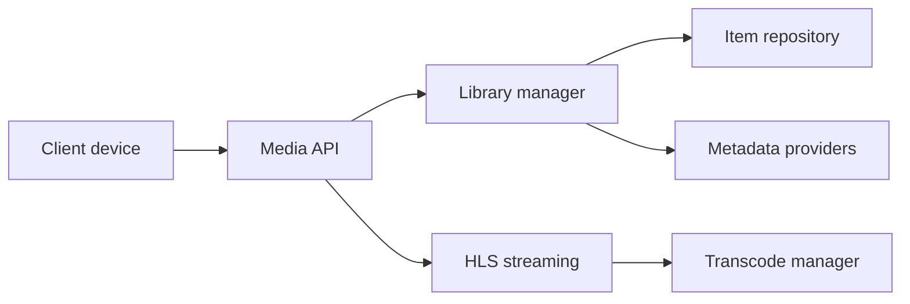

# jellyfin/jellyfin

> Free media server that organizes and streams your media to users' devices.

## The problem
Plex and Emby are proprietary; you need a media server without a premium license or locked features.

## What it actually does
.NET backend that manages libraries, queries metadata, keeps user state and streams over HLS with transcoding via ffmpeg. The web client is a separate repository, hosted by the server by default. Descendant of Emby 3.5.2.

## How it is wired


## Trying it
```bash
git clone https://github.com/jellyfin/jellyfin.git
cd jellyfin
dotnet run --project Jellyfin.Server --webdir /absolute/path/to/jellyfin-web/dist
```

## Cost and gotchas
Free. Requires the .NET 10 SDK, ffmpeg and the web client files. FreeBSD remains incompatible. The setup wizard does not work if the web client is hosted separately.

## What it is not
This repository's README is aimed at server development, not usage: downloads and the installation guide are on the website.

## Alternatives
Emby and Plex, cited as proprietary alternatives to Jellyfin.

## For you
Ignore for data / AI watch: personal media server unrelated to the job.
