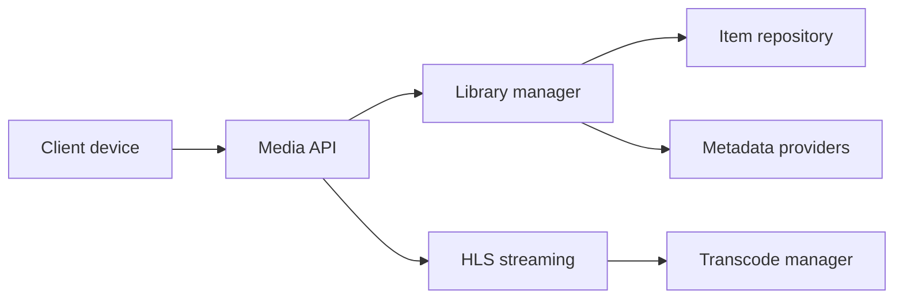

# jellyfin/jellyfin

> Serveur multimédia libre qui organise et diffuse vos médias vers les appareils des utilisateurs.

## Le problème
Plex et Emby sont propriétaires ; il faut un serveur média sans licence premium ni fonctionnalités verrouillées.

## Ce que ça fait vraiment
Backend .NET qui gère les bibliothèques, interroge les métadonnées, conserve l'état des utilisateurs et diffuse en HLS avec transcodage via ffmpeg. Le client web est un dépôt séparé, hébergé par défaut par le serveur. Descendant d'Emby 3.5.2.

## Comment c'est branché


## Essayer
```bash
git clone https://github.com/jellyfin/jellyfin.git
cd jellyfin
dotnet run --project Jellyfin.Server --webdir /absolute/path/to/jellyfin-web/dist
```

## Coût et pièges
Gratuit. Il faut le SDK .NET 10, ffmpeg et les fichiers du client web. FreeBSD reste incompatible. L'assistant d'installation ne marche pas si le client web est hébergé séparément.

## Ce que ce n'est pas
Le README de ce dépôt est orienté développement du serveur, pas utilisation : les téléchargements et le guide d'installation sont sur le site.

## Alternatives
Emby et Plex, cités comme alternatives propriétaires à Jellyfin.

## Pour toi
À ignorer pour la veille data / IA : serveur média personnel sans lien avec le métier.

