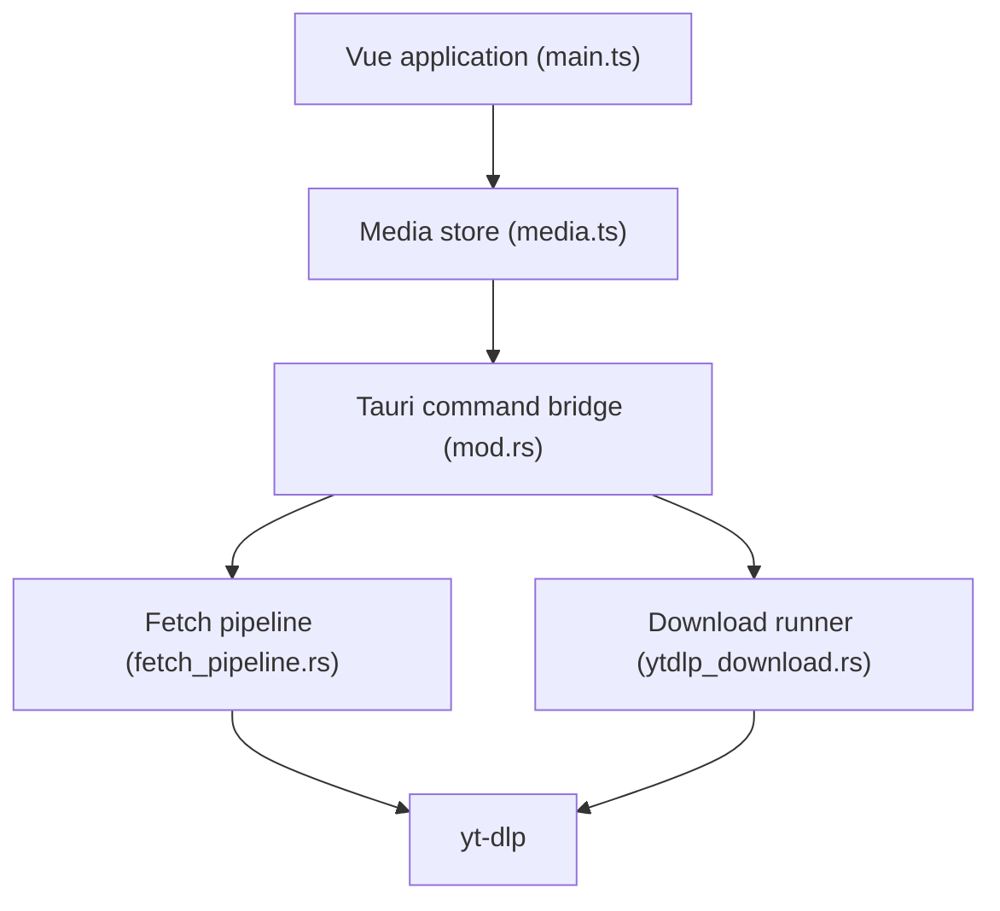

# jely2002/youtube-dl-gui

> Desktop interface around yt-dlp for downloading videos, audio and subtitles.

## The problem
yt-dlp requires the command line, which many users avoid.

## What it actually does
Vue 3 and Tauri (Rust) application that drives yt-dlp: fetches the info of a URL or playlist, picks quality and format, manages a download queue, cookies and credentials, and updates both the app and yt-dlp. Installers for Windows, macOS, Linux.

## How it is wired


## Trying it
```bash
brew install --cask open-video-downloader
winget install -e --id jely2002.youtube-dl-gui
```

## Cost and gotchas
Free. AGPL-3.0 license. The Microsoft Store version receives updates more slowly and without automatic yt-dlp updates. Complying with the platforms' terms is on you.

## What it is not
Not a standalone downloader: it depends on yt-dlp. The maintainers disclaim any responsibility in case of misuse.

## Alternatives
yt-dlp, used on the command line, of which this interface is a graphical layer. The README names no other alternative.

## For you
Watch: handy for grabbing videos or subtitles as raw material, but it is a layer over yt-dlp that you can call directly.
