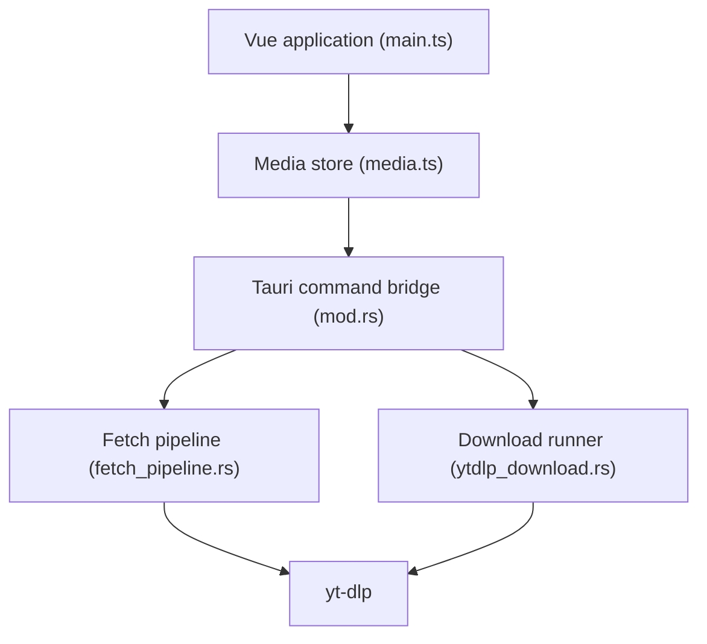

# jely2002/youtube-dl-gui

> Interface de bureau autour de yt-dlp pour télécharger vidéos, audio et sous-titres.

## Le problème
yt-dlp demande la ligne de commande, que beaucoup d'utilisateurs évitent.

## Ce que ça fait vraiment
Application Vue 3 et Tauri (Rust) qui pilote yt-dlp : récupère les infos d'une URL ou d'une playlist, choisit qualité et format, gère une file de téléchargements, les cookies et identifiants, et met à jour l'app et yt-dlp. Installeurs Windows, macOS, Linux.

## Comment c'est branché


## Essayer
```bash
brew install --cask open-video-downloader
winget install -e --id jely2002.youtube-dl-gui
```

## Coût et pièges
Gratuit. Licence AGPL-3.0. La version du Microsoft Store reçoit les mises à jour plus lentement et sans mise à jour auto de yt-dlp. Respect des conditions des plateformes à ta charge.

## Ce que ce n'est pas
Pas un téléchargeur autonome : il dépend de yt-dlp. Les maintenants déclinent toute responsabilité en cas de mauvais usage.

## Alternatives
yt-dlp, utilisé en ligne de commande.

## Pour toi
À surveiller : pratique pour récupérer des vidéos ou sous-titres comme matière brute, mais c'est une surcouche à yt-dlp que tu peux appeler directement.

