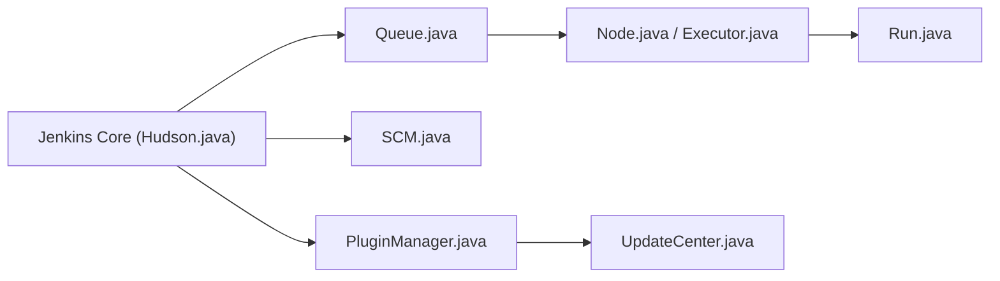

# jenkinsci/jenkins

> Open source automation server to build, test and deploy, extended by more than 2,000 plugins.

## The problem
Repetitive builds, tests and deployments eat up teams' time when they are not automated.

## What it actually does
Schedules jobs, runs them on agents through a queue and executors, integrates with source managers and is extended through plugins. Distributed as WAR, Docker images, native packages and installers, with two lines: weekly and LTS. The README does not detail installation.

## How it is wired

## Trying it
No command documented in the README; see the project's Downloads page.

## Cost and gotchas
Free, but you must host and maintain it yourself; the plugin ecosystem requires regular updates. The README does not detail security.

## What it is not
Not a managed service. 3,620 open issues: a massive project, not a light one.

## Alternatives
No alternative named in the README.

## For you
Relevant for legacy MLOps CI/CD; for a new project, look first at a CI built into the forge, to avoid having to host a server.
