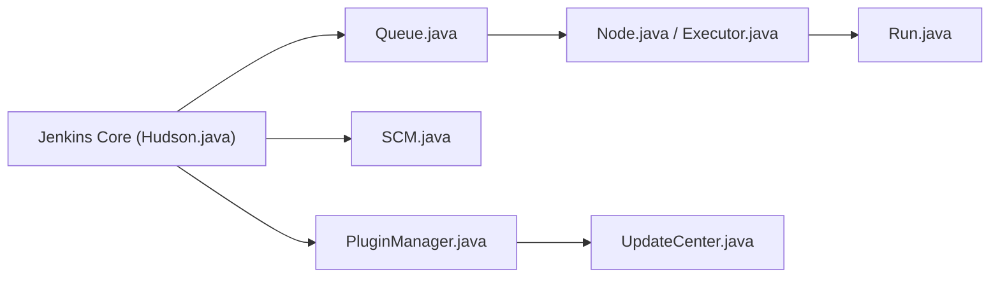

# jenkinsci/jenkins

> Serveur d'automatisation open source pour construire, tester et déployer, étendu par plus de 2 000 plugins.

## Le problème
Les builds, tests et déploiements répétitifs mangent le temps des équipes quand ils ne sont pas automatisés.

## Ce que ça fait vraiment
Planifie des jobs, les exécute sur des agents via une file et des exécuteurs, s'intègre aux gestionnaires de sources et s'étend par plugins. Distribué en WAR, images Docker, paquets natifs et installeurs, avec deux lignes : hebdomadaire et LTS. Le README ne détaille pas l'installation.

## Comment c'est branché

## Essayer
Aucune commande documentée dans le README ; voir la page Downloads du projet.

## Coût et pièges
Gratuit, mais à héberger et à maintenir soi-même ; l'écosystème de plugins demande des mises à jour suivies. Le README ne détaille pas la sécurité.

## Ce que ce n'est pas
Pas un service géré. 3 620 issues ouvertes : projet massif, pas léger.

## Alternatives
Aucune alternative nommée dans le README.

## Pour toi
Pertinent pour du CI/CD MLOps hérité ; pour un nouveau projet, on regarde d'abord un CI intégré à la forge, faute d'avoir à héberger un serveur.

