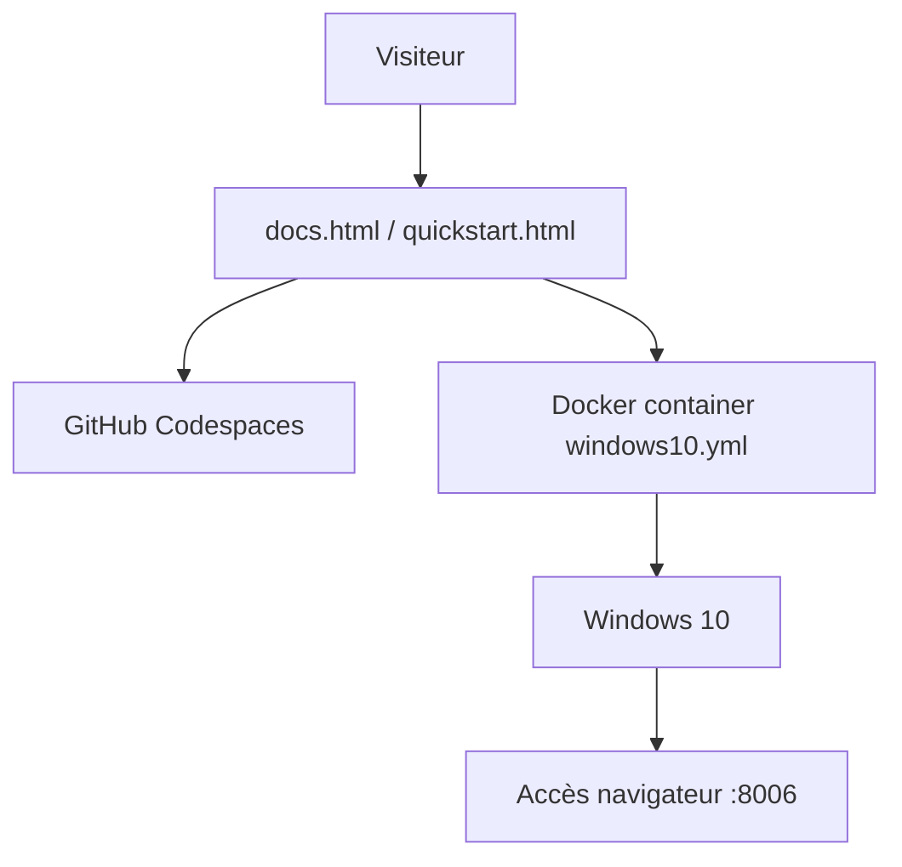

# jephersonRD/PC-Free

> Guide to running Windows 10 in a Docker container inside a GitHub Codespace, accessible from the browser.

## The problem
Use Windows without a Windows machine or a heavy local installation.

## What it actually does
The repository is mostly a showcase site and a guide. It provides a Docker Compose `windows10.yml` based on the `dockurr/windows` image (10 GB of RAM, 4 cores, KVM), commands to move Docker's data root, and a web interface on port 8006 or RDP on 3389. The Windows container code is not in the repository.

## How it is wired



## Trying it
```bash
sudo mkdir -p /tmp/docker-data
docker info
docker-compose -f windows10.yml up -d
docker logs -f windows
docker stop windows
```

## Cost and gotchas
The 60 monthly Codespaces hours of the free tier limit usage; 10 GB of RAM and KVM are required. The example file mentions a GitHub follow check (`check_github_follow.sh`) before startup. The README asks for a valid Windows license. The catalogue detects no license, although the README mentions MIT.

## What it is not
Not a hosted Windows: everything runs in your Codespace, without a GPU. Not suited to modern gaming, says the README.

## Alternatives
dockurr/windows: the Docker image the guide is built on.

## For you
Ignore: a simple recipe around `dockurr/windows`, with no declared license; use the upstream project directly.
