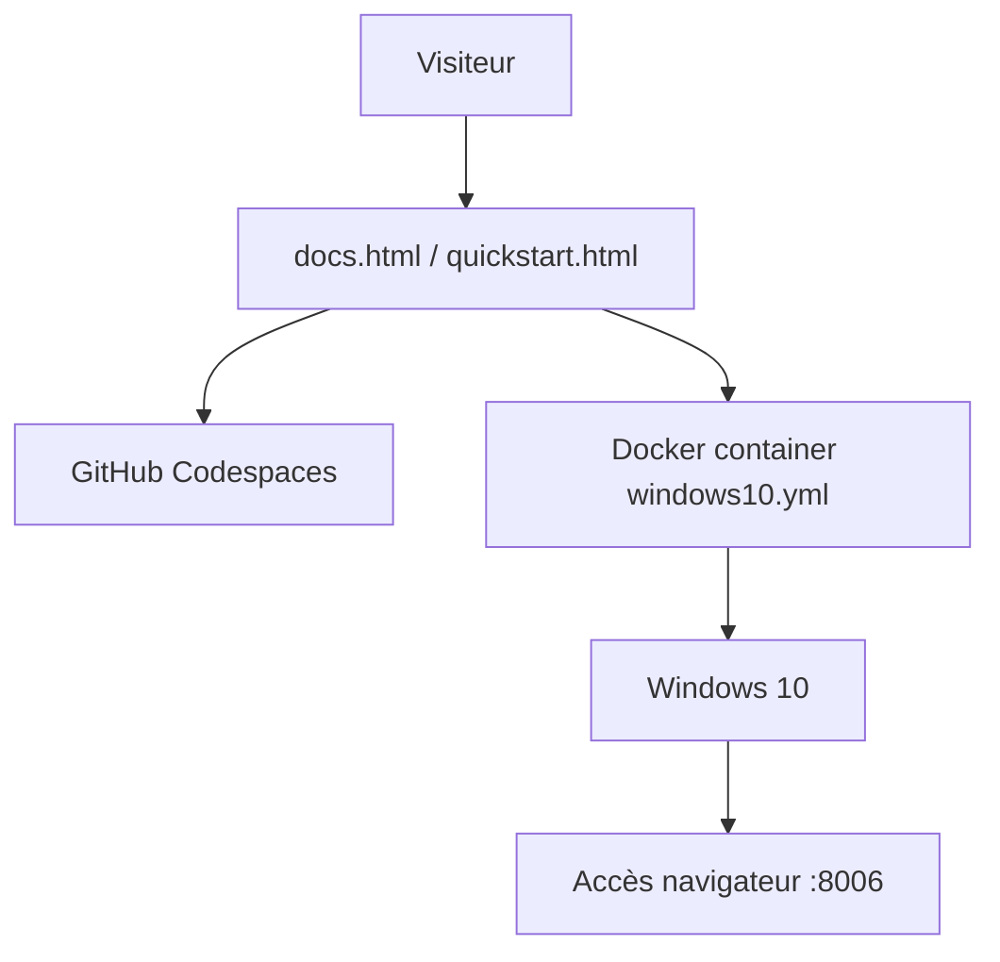

# jephersonRD/PC-Free

> Guide pour lancer Windows 10 dans un conteneur Docker au sein d'un GitHub Codespace, accessible depuis le navigateur.

## Le problème
Utiliser Windows sans machine Windows ni installation locale lourde.

## Ce que ça fait vraiment
Le dépôt est surtout un site de présentation et un guide. Il fournit un `windows10.yml` Docker Compose basé sur l'image `dockurr/windows` (10 Go de RAM, 4 cœurs, KVM), des commandes pour déplacer la racine de données de Docker, et une interface web sur le port 8006 ou RDP sur 3389. Le code du conteneur Windows n'est pas dans le dépôt.

## Comment c'est branché



## Essayer
```bash
sudo mkdir -p /tmp/docker-data
docker info
docker-compose -f windows10.yml up -d
docker logs -f windows
docker stop windows
```

## Coût et pièges
Les 60 heures mensuelles de Codespaces du palier gratuit limitent l'usage ; 10 Go de RAM et KVM requis. Le fichier d'exemple mentionne un contrôle d'abonnement GitHub (`check_github_follow.sh`) avant le démarrage. Le README demande une licence Windows valide. Le catalogue ne détecte aucune licence, bien que le README parle de MIT.

## Ce que ce n'est pas
Pas un Windows hébergé : tout tourne dans ton Codespace, sans GPU. Pas adapté au jeu moderne, dit le README.

## Alternatives
dockurr/windows : l'image Docker sur laquelle repose le guide.

## Pour toi
À ignorer : simple recette autour de `dockurr/windows`, sans licence déclarée ; utilise directement le projet amont.

