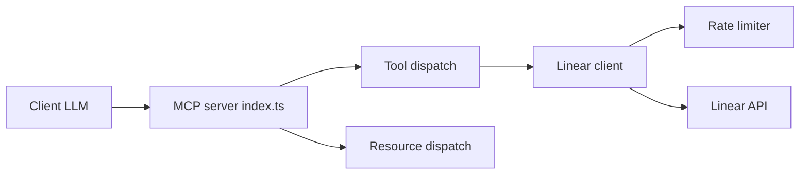

# jerhadf/linear-mcp-server

> MCP server giving an LLM access to Linear issues; deprecated in favor of the official server.

## The problem
An AI assistant cannot create or search Linear issues without a bridge to its API.

## What it actually does
Stdio server exposing five tools (create, update, search issues, a user's issues, comments) and resources (issue, team, user, organization). Everything lives in `index.ts`, with a rate limiter. The README announces that it is no longer maintained.

## How it is wired


## Trying it
```bash
npx @smithery/cli install linear-mcp-server --client claude
npm install
npm run build
```

## Cost and gotchas
Free; requires a Linear API key. No maintenance since May 2025.

## What it is not
No longer maintained: the author recommends Linear's official remote MCP server (mcp.linear.app/sse).

## Alternatives
- Linear's official MCP server: the route recommended by the author.

## For you
Ignore: deprecated by its author; use Linear's official server.
