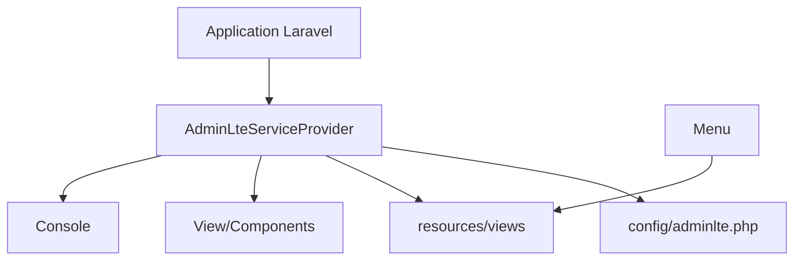

# jeroennoten/Laravel-AdminLTE

> Laravel package that plugs in the AdminLTE v4 admin template and provides a Blade layout and a menu.

## The problem
Setting up a consistent Laravel admin panel requires manually integrating the template, the menu and the authentication views.

## What it actually does
The package provides a Blade layout to extend, an advanced menu configuration system and, optionally, AdminLTE-styled authentication views. It builds on AdminLTE 4 (Bootstrap 5.3, no jQuery), installed by Composer. From the code: a service provider publishes the configuration and views, Blade components, console commands, events and helpers.

## How it is wired


## Trying it
```bash
# Aucune commande dans le README : il renvoie au guide d'installation du site de documentation.
```

## Cost and gotchas
Free. Requires Laravel 12 or 13 and PHP 8.2 or later. Versions 1.x to 3.x are no longer maintained. Moving from 3.x to 4.x requires a migration guide.

## What it is not
Not a complete admin application: it is a theme and a layout. The architecture explanation provided still talks about AdminLTE v3, in disagreement with the README (v4): I followed the README.

## Alternatives
No alternative named in the README.

## For you
Ignore: useful only for a Laravel admin panel, unrelated to data or AI.
