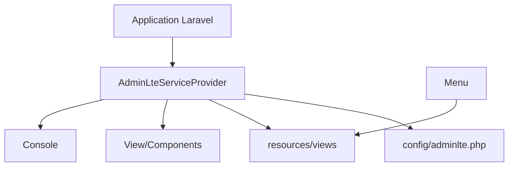

# jeroennoten/Laravel-AdminLTE

> Paquet Laravel qui branche le modèle d'administration AdminLTE v4 et fournit un gabarit Blade et un menu.

## Le problème
Monter un panneau d'administration Laravel cohérent demande d'intégrer à la main le modèle, le menu et les vues d'authentification.

## Ce que ça fait vraiment
Le paquet fournit un gabarit Blade à étendre, un système de configuration de menu avancé et, en option, des vues d'authentification au style AdminLTE. Il s'appuie sur AdminLTE 4 (Bootstrap 5.3, sans jQuery), installé par Composer. D'après le code : un fournisseur de services publie la configuration et les vues, des composants Blade, des commandes console, des événements et des aides.

## Comment c'est branché


## Essayer
```bash
# Aucune commande dans le README : il renvoie au guide d'installation du site de documentation.
```

## Coût et pièges
Gratuit. Il faut Laravel 12 ou 13 et PHP 8.2 ou plus. Les versions 1.x à 3.x ne sont plus maintenues. La passe de 3.x à 4.x demande un guide de migration.

## Ce que ce n'est pas
Ce n'est pas une application d'administration complète : c'est un thème et un gabarit. L'explication d'architecture fournie parle encore d'AdminLTE v3, en désaccord avec le README (v4) : j'ai suivi le README.

## Alternatives
Aucune alternative nommée dans le README.

## Pour toi
À ignorer : utile seulement pour un panneau d'administration Laravel, sans lien avec la data ou l'IA.

