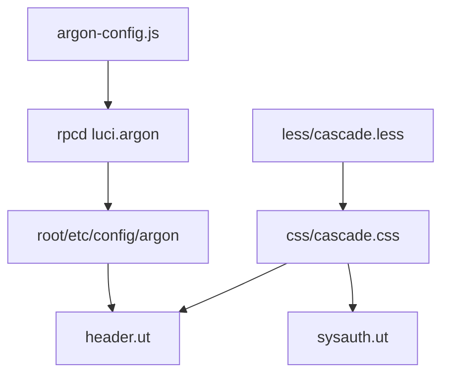

# jerrykuku/luci-theme-argon

> LuCI interface theme for OpenWrt routers, with a customizable login page and light or dark mode.

## The problem
OpenWrt's default web interface is austere and poorly suited to narrow screens.

## What it actually does
It replaces LuCI's styling: two login layouts, light and dark themes, image or video backgrounds (local, Bing, Unsplash with a key, Wallhaven), custom logo and icon. An "Argon Config" page manages the settings. Since 3.1, an online update installs the package via APK or OPKG with SHA256 verification.

## How it is wired


## Trying it
```bash
opkg install ./luci-theme-argon_*.ipk
apk add --allow-untrusted ./luci-theme-argon-*.apk
```

## Cost and gotchas
Free. You need an OpenWrt router and the right package format. Users of 3.0 or earlier must install 3.1.3 manually once. The old `luci-app-argon-config` plugin conflicts if it is still installed. Unsplash requires an API key.

## What it is not
Not a network management tool: it only changes the look of the interface.

## Alternatives
No alternative named in the README, which only thanks luci-theme-material.

## For you
Ignore: router cosmetics, unrelated to your data or MLOps work.
