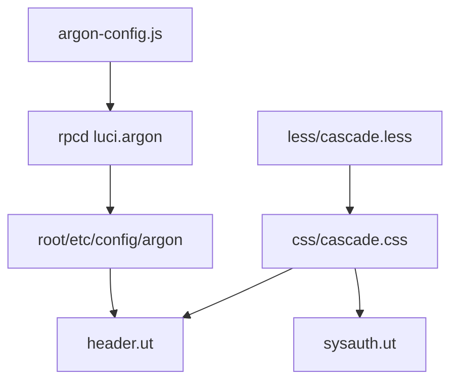

# jerrykuku/luci-theme-argon

> Thème d'interface LuCI pour routeurs OpenWrt, avec page de connexion personnalisable et mode clair ou sombre.

## Le problème
L'interface web par défaut d'OpenWrt est austère et peu adaptée aux écrans étroits.

## Ce que ça fait vraiment
Il remplace le style de LuCI : deux mises en page de connexion, thèmes clair et sombre, fonds image ou vidéo (locaux, Bing, Unsplash avec clé, Wallhaven), logo et icône personnalisés. Une page « Argon Config » gère les réglages. Depuis la 3.1, une mise à jour en ligne installe le paquet via APK ou OPKG avec vérification SHA256.

## Comment c'est branché


## Essayer
```bash
opkg install ./luci-theme-argon_*.ipk
apk add --allow-untrusted ./luci-theme-argon-*.apk
```

## Coût et pièges
Gratuit. Il faut un routeur OpenWrt et le bon format de paquet. Les utilisateurs de la 3.0 ou avant doivent installer la 3.1.3 à la main une fois. L'ancien plugin `luci-app-argon-config` entre en conflit s'il reste installé. Unsplash demande une clé d'API.

## Ce que ce n'est pas
Ce n'est pas un outil de gestion réseau : il ne change que l'apparence de l'interface.

## Alternatives
Aucune alternative nommée dans le README, qui remercie seulement luci-theme-material.

## Pour toi
À ignorer : cosmétique pour routeur, sans lien avec ton travail data ou MLOps.

