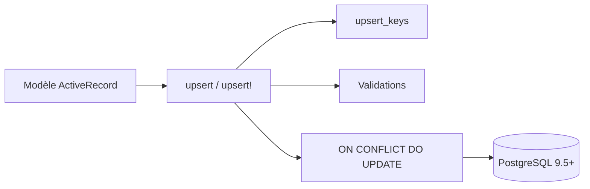

# jesjos/active_record_upsert

> Ruby gem that adds a true PostgreSQL upsert to ActiveRecord, for Rails applications.

## The problem
At the time, Rails had no single-record upsert with validations, callbacks and timestamps.

## What it actually does
Adds `upsert` as a class and instance method, via `ON CONFLICT DO UPDATE`. Respects timestamps, validates the object, allows conflict keys (`upsert_keys`), partial indexes and an Arel condition. Loads existing data for a partial upsert.

## How it is wired

Simplified diagram based on the sheet, no diagram provided.

## Trying it
```bash
gem install active_record_upsert
bundle
bin/run_rails.sh db:create db:migrate DATABASE_URL=postgresql://localhost/upsert_test
```

## Cost and gotchas
Free. Ruby MRI with the `pg` gem and PostgreSQL 9.5 or later; JRuby not supported. Avoid versions 0.9.2 and 0.9.3. Watch out for the column default values case, described in the README.

## What it is not
Not a bulk `upsert_all`. The README itself recommends using Rails' native `upsert` if your version allows it.

## Alternatives
Rails' native `ActiveRecord::Persistence#upsert` (Rails 6 and later): no dependency, but no validations or callbacks.

## For you
Useful only in a Rails application on PostgreSQL; outside your data or AI profile, and Rails now provides a native upsert.
