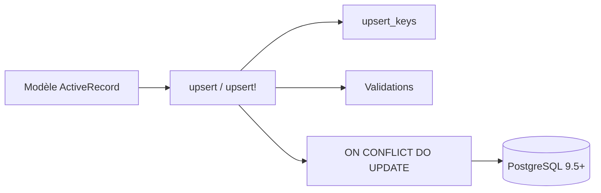

# jesjos/active_record_upsert

> Gem Ruby qui ajoute un vrai upsert PostgreSQL à ActiveRecord, pour applications Rails.

## Le problème
À l'époque, Rails n'avait pas d'upsert sur un seul enregistrement avec validations, rappels et horodatages.

## Ce que ça fait vraiment
Ajoute `upsert` en méthode de classe et d'instance, via `ON CONFLICT DO UPDATE`. Respecte les horodatages, valide l'objet, permet des clés de conflit (`upsert_keys`), des index partiels et une condition Arel. Charge les données existantes pour un upsert partiel.

## Comment c'est branché

Schéma simplifié d'après la fiche, sans diagramme fourni.

## Essayer
```bash
gem install active_record_upsert
bundle
bin/run_rails.sh db:create db:migrate DATABASE_URL=postgresql://localhost/upsert_test
```

## Coût et pièges
Gratuit. Ruby MRI avec le gem `pg` et PostgreSQL 9.5 ou plus ; JRuby non pris en charge. Éviter les versions 0.9.2 et 0.9.3. Attention au cas des valeurs par défaut de colonne, décrit dans le README.

## Ce que ce n'est pas
Pas un `upsert_all` en masse. Le README recommande lui-même d'utiliser l'`upsert` natif de Rails si la version le permet.

## Alternatives
`ActiveRecord::Persistence#upsert` natif de Rails (6 et plus) : sans dépendance, mais sans validations ni rappels.

## Pour toi
Utile seulement dans une application Rails sur PostgreSQL ; hors profil data ou IA, et Rails fournit désormais un upsert natif.

