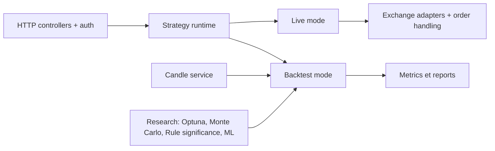

# jesse-ai/jesse

> Python crypto trading framework to research, backtest, optimize and deploy your own strategies.

## The problem
Writing and validating a trading strategy requires combining data, indicators, look-ahead-bias-free simulation and live execution.

## What it actually does
You define a strategy in Python (`should_long`, `go_long`), then backtest it, optimize it (Optuna, Ray), and deploy it in paper or live mode. It includes more than 300 indicators (Rust implementation), a rule significance test, Monte Carlo analysis, a machine learning pipeline (scikit-learn), a research API for Jupyter notebooks and a local MCP server. All of it is self-hosted, with interactive charts and notifications.

## How it is wired

## Trying it
No command documented in the README: it points to the "getting started" section of the online documentation.

## Cost and gotchas
Free and self-hosted, but the architecture described from the code cites Redis (pub/sub) and exchanges. The README warns: use at your own risk, educational software, possible bugs, no guarantee, do not risk money you cannot afford to lose.

## What it is not
It is not a system that guarantees a profit: a backtest does not predict the future. Reinforcement learning is announced as "coming soon", not delivered.

## Alternatives
TA-Lib: named as a speed reference for indicators only.

## For you
Watch: its building blocks (Monte Carlo, ML, research API, MCP) speak to a data/AI profile, but installation is not described here and risky finance calls for caution.
