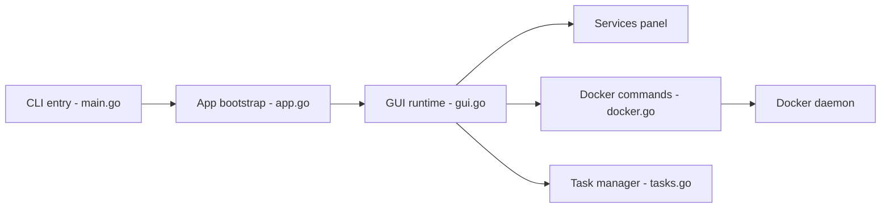

# jesseduffield/lazydocker

> Terminal interface for Docker and Docker Compose: containers, logs, metrics and actions at a keystroke.

## The problem
Keeping track of your containers means chaining `docker-compose ps`, `logs`, `restart` across several terminals, while remembering the commands.

## What it actually does
A Go TUI (gocui) that shows the state of containers and services, their logs, customizable ASCII metric graphs, and lets you attach, restart, remove, rebuild, view image layers and prune containers/images/volumes. Mouse supported.

## How it is wired


## Trying it
```bash
brew install jesseduffield/lazydocker/lazydocker
go install github.com/jesseduffield/lazydocker@latest
lazydocker
```

## Cost and gotchas
Free. Requires Docker ≥ 29.0.0; Compose ≥ 1.23.2 optional. Logs are limited to the last hour by default; inside a Docker container, logs and CPU are a known bug.

## What it is not
Not a tool for creating/configuring containers: it manages what already exists. No web interface.

## Alternatives
- docui: rather for creating and configuring containers.
- Portainer: same need in the browser, with Swarm.

## For you
Adopt: immediate time saver for anyone juggling Docker stacks locally (inference servers, databases), with no cost or dependency.
