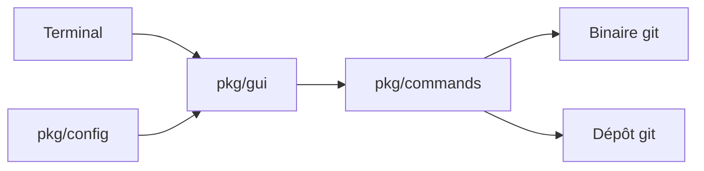

# jesseduffield/lazygit

> Terminal interface for git: stage lines, rebase, cherry-pick without memorizing the commands.

## The problem
Advanced git operations (partial staging, interactive rebase, editing old commits) require long commands or manual file editing.

## What it actually does
lazygit shows the repository, branches, commits and diff in a terminal screen. You stage lines or hunks, run an interactive rebase (squash, fixup, drop), do cherry-picks, a bisect, worktrees, and a reflog-based undo/redo. Custom commands are defined in configuration.

## How it is wired


## Trying it
```bash
brew install lazygit
lazygit --version
lazygit
```

## Cost and gotchas
Free. Displaying GitHub pull requests requires `gh` installed and `gh auth login`. Undo (`z`) goes through the reflog: it covers neither the working tree nor the stash.

## What it is not
Not a replacement for git: it drives the git binary that is present. The "nuke" option really deletes local changes.

## Alternatives
- GitUI, tig, GitArbor TUI: cited in the README as other terminal interfaces.

## For you
Adopt: versioning notebooks and MLOps code benefits from a clean rebase, and the tool costs only a binary.
