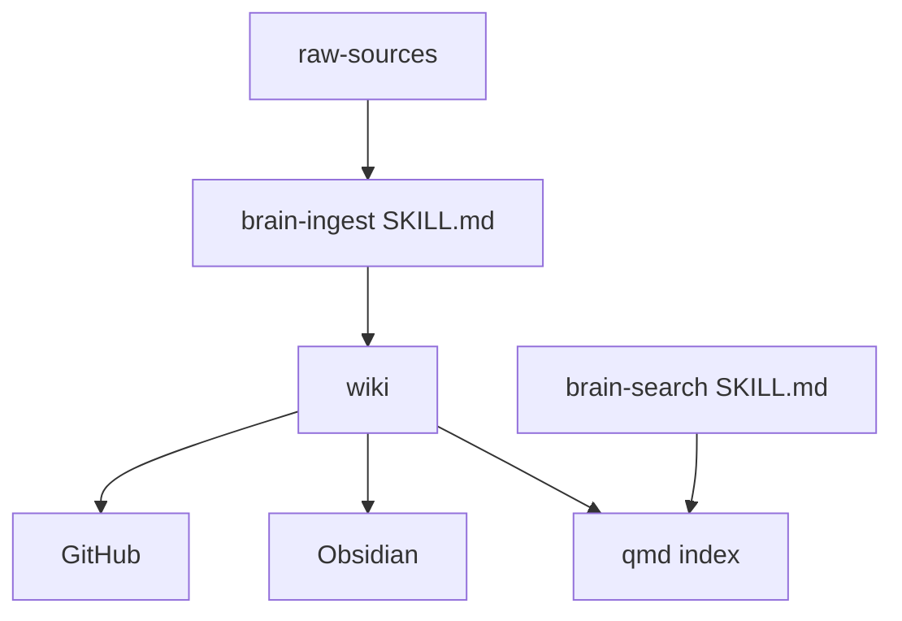

# jessepinkman9900/claude-second-brain

> Generates an Obsidian knowledge base maintained by Claude Code, for anyone who wants a personal wiki.

## The problem
Accumulated notes and readings do not link to each other and cannot be found again six months later.

## What it actually does
`npx claude-second-brain` creates an Obsidian vault under `~/.claude-second-brain/`. Claude Code commands (`/brain-ingest`, `/brain-search`, `/lint`, `/brain-refresh`, `/brain-rebuild`) read the sources dropped into `raw-sources/`, write linked pages into `wiki/`, and query a local qmd index (vector and BM25). GitHub serves as the source of truth. The README states that this is not a RAG.

## How it is wired


## Trying it
```bash
npx claude-second-brain
cd ~/.claude-second-brain/my-brain
pnpm qmd:reindex
```

## Cost and gotchas
First indexing: about 2 GB of GGUF models downloaded. You need Claude Code (so your subscription or your key), and the CLI installs `mise`, node and pnpm.

## What it is not
Not a chatbot over your notes and not a RAG. `/brain-rebuild` is destructive. The skills' code was not read; only the CLI and qmd were.

## Alternatives
None cited in the README (it is inspired by an approach from Andrej Karpathy).

## For you
Worth watching: a good practical implementation of an LLM-maintained wiki, useful for your watch, but the project has two weeks of activity and a single author.
