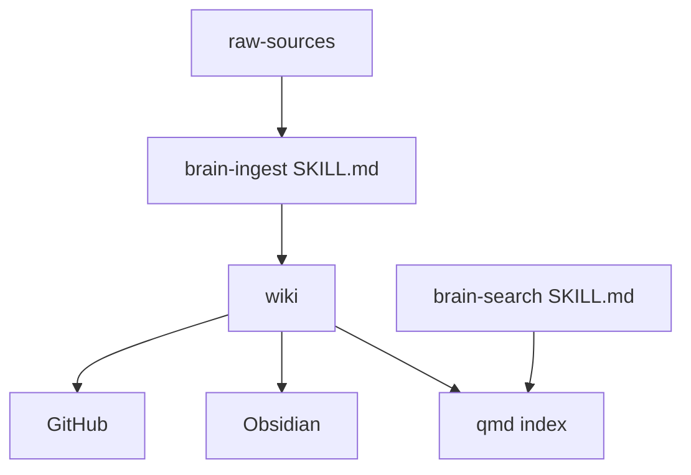

# jessepinkman9900/claude-second-brain

> Génère une base de connaissances Obsidian maintenue par Claude Code, pour qui veut un wiki personnel.

## Le problème
Des notes et lectures accumulées ne se relient pas et ne se retrouvent pas six mois plus tard.

## Ce que ça fait vraiment
`npx claude-second-brain` crée un coffre Obsidian sous `~/.claude-second-brain/`. Des commandes Claude Code (`/brain-ingest`, `/brain-search`, `/lint`, `/brain-refresh`, `/brain-rebuild`) lisent les sources déposées dans `raw-sources/`, écrivent des pages liées dans `wiki/`, et interrogent un index qmd local (vectoriel et BM25). GitHub sert de source de vérité. Le README précise que ce n'est pas un RAG.

## Comment c'est branché


## Essayer
```bash
npx claude-second-brain
cd ~/.claude-second-brain/my-brain
pnpm qmd:reindex
```

## Coût et pièges
Premier indexage : environ 2 Go de modèles GGUF téléchargés. Il faut Claude Code (donc ton abonnement ou ta clé), et le CLI installe `mise`, node et pnpm.

## Ce que ce n'est pas
Pas un chatbot sur tes notes ni un RAG. `/brain-rebuild` est destructif. Le code des skills n'a pas été lu, seuls le CLI et qmd l'ont été.

## Alternatives
Aucune citée dans le README (il s'inspire d'une approche d'Andrej Karpathy).

## Pour toi
À surveiller : bonne mise en pratique du wiki entretenu par un LLM, utile à ta veille, mais projet de deux semaines d'activité et d'un seul auteur.

